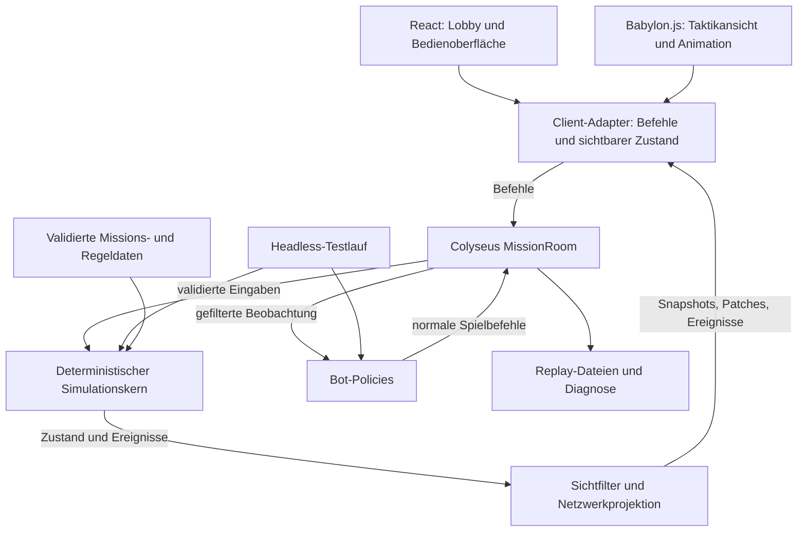

# NEON CONTRACT – Technisches Architekturkonzept

Stand: 20.10.2026 · Status: Vorschlag zur gemeinsamen Prüfung, keine Implementierungsfreigabe. Die Taktikansicht ist am 21.10.2026 durch [0007](decisions/0007-babylon-taktikansicht.md) festgelegt.

Grundlage: [Originalkonzept](../NEON_CONTRACT_Konzept.md). Produktumfang und konkrete Startwerte stehen in [PROTOTYP.md](PROTOTYP.md); Reihenfolge und Abnahme in [ENTWICKLUNGSPLAN.md](ENTWICKLUNGSPLAN.md).

Die detaillierte Zerlegung steht in [MODULE.md](MODULE.md), die Benutzerführung in [SCREENS.md](SCREENS.md), die Inhaltserstellung in [GENERATOREN.md](GENERATOREN.md) und die einzelnen Umsetzungsschritte in [ARBEITSPAKETE.md](ARBEITSPAKETE.md).

## 1. Architekturentscheidung

Empfohlen wird ein TypeScript-Monorepo mit einem eigenständigen, deterministischen Regelkern. Ein autoritativer Node-Server führt Missionen aus. Browser und Bots liefern Befehle; sie entscheiden weder über Treffer noch über AP oder Missionsausgänge.

Babylon.js zeichnet die Taktikansicht und verarbeitet ihre Karteneingaben. Die Kamera ist orthografisch, um 45 Grad geneigt, dreht in 90-Grad-Schritten und lässt Zoom zu. React übernimmt Lobby, Aktionsleiste, Ausrüstung, Timer und Missionsanzeige. Colyseus verwaltet Verbindungen, Räume und die Übertragung des sichtbaren Zustands. Keines dieser Frameworks darf Voraussetzung für die Simulation sein. Die Fortsetzung dieser Ansicht ist die spielbare Fassung von `?stueck=raster` und `?stueck=sicht`, siehe [0013](decisions/0013-isometrische-fortsetzung.md). Seit [0024](decisions/0024-ein-start-fuer-die-testmission.md) ist `http://127.0.0.1:5173/` dieselbe Testmission. Die älteren Phaser-Ansichten bleiben erreichbar.

Das bewahrt den entscheidenden Entwicklungsweg: Eine neue Regel lässt sich ohne Browser mit einem festen Seed testen; genau dieselbe Regel läuft anschließend in der gemeinsamen Mission.



Pfeile zeigen Datenfluss. Die erlaubten Code-Abhängigkeiten sind enger: Der Regelkern importiert weder Server, Bots, Netzwerk, React, Babylon.js noch Phaser.

## 2. Was feststeht, was vorgeschlagen wird

Aus dem Konzept übernommen: 4–8 Spieler als Produktziel, ein Hauptcharakter je Person, taktischer Schwerpunkt, beide Zugmodelle erproben, Begleiter ohne eigenen Vollzug, Headless-Tests, Bots, Hotjoin und Reconnect, später persistente Kampagne.

Neue Vorschläge: orthogonales Raster mit ganzzahligen Höhenstufen und ohne Höhenbonus; Teamzug zuerst; vier Runner im ersten spielbaren Zwischenstand; acht im anschließenden Validierungsschritt; gemeinsame Teamsicht; ein Serverprozess; Kampagnenpersistenz nach dem Taktiktest. Diese Eingrenzungen sind zu prüfen, keine nachträglich behaupteten Konzeptentscheidungen. Die Darstellung selbst ist in [0007](decisions/0007-babylon-taktikansicht.md) entschieden.

Bewusst vermieden werden zunächst Microservices, eine allgemeine ECS-Plattform, clientseitiger Lockstep, Rollback-Netcode und ein frei skriptbares Modsystem. Das ist für eine kleine rundenbasierte Mission unnötige Infrastruktur.

## 3. Stack und Versionsstrategie

- **TypeScript:** gemeinsame Domain-Typen, `strict` und zusätzlich `noUncheckedIndexedAccess`; externe Daten trotzdem zur Laufzeit validieren.
- **Node.js 24 LTS:** vorgeschlagene Server- und Testlaufzeit. Konkrete Patchversion beim ersten Infrastruktur-Schritt festlegen.
- **Babylon.js:** reine Darstellung, orthografische Kamera, Eingaben und Animation. Keine Physik-Engine für Spielregeln. Die Paketversion wird bei der Umsetzung festgelegt.
- **React + Vite:** DOM-Oberfläche und Browser-Build. Ein stabiler Szenen-Host mit sauberem Mount/Unmount; React-Renderzyklen dürfen keine zweite Spielinstanz erzeugen. Neue Taktikoberflächen setzen den Babylon-Host von `?stueck=raster` und `?stueck=sicht` fort.
- **Colyseus:** ein `MissionRoom` pro Einsatz, WebSocket-Transport, serverseitige Befehlsverarbeitung und Zustandsprojektion.
- **Vitest:** Regeln, Invarianten, Replays, Bots und Raum-Integration. **Playwright:** Browserabläufe und mehrere unabhängige Spieler-Sessions.
- **pnpm Workspaces:** einfacher Monorepo-Aufbau. Noch kein zusätzlicher Build-Orchestrator.
- **Karten-JSON:** logisches Raster, Deckungskanten und Sichtlinien-Blocker. Ein Importer übersetzt exportierte Editor-JSON in dieses Format; die Datei enthält keinen ausführbaren Code.

Am 20.10.2026 verweist die offizielle stabile Phaser-Seite auf **4.2.1**, veröffentlicht am 09.07.2026. Diese Fassung ist installiert und trägt die bisherigen Gefechtsstücke. Seit dem 21.10.2026 ist Babylon.js die Zielansicht; seine Version wird erst bei der Umsetzung gegen die installierte API geprüft und danach im Lockfile festgehalten. Die geprüfte Colyseus-Dokumentation zeigt **0.18**. Das ist noch kein Nachweis, dass beliebige Paketkombinationen zusammenpassen.

Kompatible Versionen von Server, SDK, Schema, React, Vite, Vitest und bei der Ansichtsumsetzung Babylon.js bleiben exakt im Lockfile. Keine automatischen Major-Upgrades. Der Paketstand der Installation ist maßgeblich, nicht ein unversioniertes Tutorial.

## 4. Vorgeschlagene Projektstruktur

**Stand 21.10.2026:** Für den beauftragten Gebäude-Prototyp existiert `packages/generator`. Es erzeugt geprüfte `MissionSpec`-Daten und importiert keine Renderer-/Netzwerkimplementierung. Die separate Werkstatt nutzt Babylon.js zur Vorschau. Die Anbindung an den laufenden Server ist offen; siehe [0009](decisions/0009-semantischer-gebaeudegenerator.md).

**Stand 22.10.2026:** `packages/bots` enthält die missionsorientierte Crew-Policy. Sie liest die Teamsicht und sendet normale Befehle. Die Simulation importiert dieses Paket nicht; siehe [0030](decisions/0030-gegnerpolicies-und-missionsbot.md).

Die folgende Struktur ist das Zielbild; einzelne Bereiche sind bereits implementiert:

```text
apps/
  client/          React, Babylon.js, Client-Adapter
  server/          Colyseus, Session-Zuordnung, Uhr, Replay-Ausgabe
packages/
  sim/             Zustand, Regeln, Geometrie, RNG, Zugauflösung
  protocol/        Transportnachrichten, Laufzeitvalidierung, Versionen
  content/         Karten und Regelwerte, Schema und Importvalidierung
  generator/       spätere Offline-Pipeline, schreibt dasselbe Missions-JSON
  bots/            Policies auf gefilterten Beobachtungen
tools/
  simulate/        Batch-Läufe, Metriken und Replay-Diagnose
tests/
  integration/     Server-, Raum- und Wiederverbindungstests
  e2e/             Browser-Tests mit 4 und später 8 Sessions
docs/
  decisions/       Kleine Entscheidungsnotizen nach der Planungsprüfung
```

`sim` definiert die Domänentypen und akzeptiert fertige, unveränderliche Missionsdaten. `content`, `protocol` und `bots` dürfen passende Typen aus `sim` verwenden; `sim` kennt deren Loader und Transportimplementierungen nicht. Regeltests liegen direkt bei `sim`. Der Headless-Runner lädt Daten und Policies, ohne Server oder Renderer zu starten.

Die 15 Fachmodule des Modulplans werden zuerst innerhalb dieser Struktur umgesetzt, nicht als 15 zusätzliche Pakete oder Dienste. `packages/generator` entsteht mit dem Generatorauftrag, liest reine Geometrieabfragen aus `sim` und schreibt dasselbe normalisierte Missions-JSON wie handgebaute Karten. Die Simulation importiert keine Generatoren. Verfahren und Reihenfolge stehen in [0008](decisions/0008-hierarchischer-missionsgenerator.md).

## 5. Simulationsvertrag

Der fachliche Vertrag lautet:

`step(state, input, rules) → { nextState, events, result }`

Dies beschreibt eine Schnittstelle, keinen bereits vorhandenen Code. `step` verändert seine Eingaben nicht und führt keine Datei-, Netzwerk-, Uhr- oder Rendering-Zugriffe aus.

**Zustand:** Mission-ID, Regel-/Content-Version, Runde, Phase, Revision, RNG-Zustand, Einheiten mit stabilen IDs, Positionen, HP/AP/Munition, Deckung, Türen, Ziele, Alarm, Controller-Zuordnung und gegebenenfalls eingereichte Pläne.

**Spielbefehle:** etwa Bewegungspfad, Schuss, Nachladen, Overwatch, Interaktion, Heilung und Extraktion. **Kontrolleingaben:** etwa Phase schließen oder Controller an einer Phasengrenze wechseln. Auch solche Eingaben werden aufgezeichnet, wenn sie den Simulationsverlauf beeinflussen.

**Ereignisse:** etwa `UnitMoved`, `ShotResolved`, `UnitIncapacitated`, `ObjectiveChanged` oder `PhaseChanged`. Sie erklären Ergebnisse und treiben Animationen an. Ein Schussereignis enthält das Ergebnis; der Client würfelt es nicht erneut.

Die Simulationszeit besteht aus Runden und diskreten Schritten. Eine reale Serverfrist erzeugt eine aufgezeichnete Eingabe `CloseTeamPhase`. Die Simulation liest niemals `Date.now()`. Ein Headless-Lauf kann dieselbe Eingabe sofort erzeugen, ohne 90 Sekunden zu warten.

### Determinismus

- Gleicher Anfangszustand, gleiche Regeln und **gleiche geordnete Eingaben** ergeben denselben Zustand und dieselben Ereignisse. Ein Seed allein genügt nicht.
- Seedbarer, versionierter PRNG mit gespeichertem Zustand; kein `Math.random()`. Bot-Entscheidungszufall und Kampfwürfe verwenden getrennte Streams.
- Integer für Raster, AP, HP, Schaden und Trefferwahrscheinlichkeiten in Basispunkten; dokumentierte Rundung und Wertebereiche.
- Stabile Reihenfolgen für Einheiten, Pfadsuche, Reaktionsfeuer und Ereignisse. Keine Abhängigkeit von Dateisystem-Reihenfolge, Locale oder zufälligen IDs.
- Vollständige Replay-Metadaten: Simulationsversion, Protokollversion, Content-Hash, Ausgangskonfiguration, Seeds, geordnete Eingaben und Checkpoints.
- Kanonische Serialisierung mit sortierten Schlüsseln/IDs für Prüfsummen. Transport- und Animationszustände gehören nicht in den Regelzustand.

Bei Variante B kann eine andere tatsächliche Ankunftsreihenfolge von Befehlen zu einem anderen Spiel führen. Der Server protokolliert diese Reihenfolge; Determinismus verspricht keine Unabhängigkeit von Netzwerklatenz.

### Geometrie und Regelauflösung

Die Karte besteht zuerst aus 20 × 20 Zellen mit vier Bewegungsrichtungen. Eine Zelle misst 1,0 Welteinheiten und trägt eine ganzzahlige Höhe. Wände, Deckung und Sichtblocker sind explizite logische Daten. GLB-Module, Pixel und Physik-Kollisionen haben keine Regelfunktion. Die Kameradrehung ändert die logischen Himmelsrichtungen nicht.

Pfadsuche hat eine feste Nachbarschafts- und Gleichstandsreihenfolge. Sichtlinien verwenden einen symmetrisch getesteten Rasterstrahl einschließlich berührter Zellen; ein exakt berührter undurchsichtiger Eckpunkt blockiert konservativ. Sichtbarkeit und Beschießbarkeit sind getrennte Abfragen mit gemeinsamem Geometriekern. Gerichtete niedrige Deckung reduziert Trefferchancen nur aus der geschützten Richtung.

Bewegung wird in Zellschritte zerlegt. Nach jedem bezahlten Schritt folgen Sichtaktualisierung, zulässige Reaktionen, Ausfallprüfung und Missionsprüfung. Ein ausgeschalteter Runner beendet seine restliche Aktion. Reaktionsschüsse erzeugen keine weiteren Reaktionsschüsse; eine begrenzte, stabile Reihenfolge verhindert Endlosschleifen.

## 6. Zwei Zugmodelle, ein Regelkern

Beide Modi teilen AP-Kosten, Treffer, Bewegung, Reaktionen und Gegnerlogik. Nur die Annahme und Reihenfolge der Crew-Befehle unterscheiden sich. Der Modus wird vor Missionsbeginn festgelegt.

### B – Gemeinsamer Teamzug, zuerst

Zyklus: `CrewStart → CrewActive → EnemyResolve → RoundEnd`.

Alle Crewmitglieder dürfen gleichzeitig Befehle senden. Der Server bearbeitet sie in einer einzigen geordneten Warteschlange; ein Bewegungspfad wird einschließlich seiner Reaktionen abgeschlossen, bevor der nächste Crew-Befehl beginnt. Das bedeutet freie gemeinsame Aktivierung bei eindeutiger logischer Auflösung.

Pro Runner ist höchstens ein unbestätigter Befehl zulässig. Vor Ausführung werden die aktuellen Voraussetzungen geprüft. Zwei Figuren können nicht dieselbe Zelle belegen; nach dem ersten erfolgreichen Zug wird der zweite gegebenenfalls abgelehnt. Ablehnung kostet keine AP und wird verständlich angezeigt.

Vorgeschlagener Startwert: 90 Sekunden gemeinsame Crewphase, einstellbar auf 60/90/120 Sekunden; frühzeitiges Ende, wenn alle aktiven Controller bereit sind. Bots melden sich nach ihren Aktionen automatisch bereit; ausgeschaltete oder extrahierte Runner blockieren das Ende nicht. Bereit ist verbindlich für diese Phase. Nicht verbrauchte AP verfallen, außer ausdrücklich bezahlten Reaktionen. Der letzte Timerablauf wird als Barriere in dieselbe Eingabereihenfolge aufgenommen: davor angenommene Befehle werden beendet, danach kommende abgewiesen.

Animationen blockieren die Simulation nicht. Der Client zeigt ausstehende Befehle, begrenzt seine Animationswarteschlange und kann zum bestätigten Zustand aufschließen.

### A – Simultane Planung, Vergleich vor der Modusentscheidung

Zyklus: `CrewStart → CrewPlanning → CrewResolve → EnemyResolve → RoundEnd`.

Spieler reichen AP-begrenzte Pläne ein und können sie bis „Bereit“ oder zur Frist ersetzen. Der Server prüft Besitz, Syntax und Planbudget; die tatsächliche Legalität wird bei der Auflösung erneut geprüft. Ein leerer Plan bedeutet Passen.

Vorschlag für die erste Vergleichsvariante: ein atomarer Schritt je Runner im Umlauf; ein Bewegungspfad liefert dabei je eine Zelle. Der Startslot rotiert pro Runde, danach folgt die feste Slotreihenfolge. Schuss und Interaktion sind jeweils ein unteilbarer Schritt. Das ist eine verständliche diskrete Auflösung ohne simulierte physikalische Gleichzeitigkeit.

Besetztes Ziel, ungültiges Schussziel oder andere nicht mehr erfüllte Voraussetzung: betroffene Aktion und restlicher Plan dieses Runners abbrechen, Rest-AP verfallen am Phasenende. Keine automatische Zielsuche oder Umleitung. Zelltausch und Überholen durch belegte Zellen sind zunächst unzulässig. Die Oberfläche erklärt Konflikte und zeigt gemeinsame Planpfade.

Abgebrochene, vor Ausführung ungültige Aktionen kosten keine AP und ziehen keine Zufallszahl. Bereits ausgeführte Bewegungsschritte bleiben bezahlt. Eine Initiative mit Geschwindigkeitswerten wird erst erwogen, wenn der Umlauf in menschlichen Tests scheitert.

## 7. Multiplayer, Zustandsbesitz und Sichtschutz

Ein Raum besitzt genau eine Mission und führt Befehle seriell aus. Simulationsschritte enthalten kein `await`; externe IO darf keine halbfertige Aktion freigeben. Eine Lobby ist zunächst der Zustand vor Missionsstart desselben Raums, kein eigener Service.

**Transportvertrag:** Jeder Befehl trägt Protokollversion, Mission-ID, eindeutige Command-ID, Round-/Phase-ID, Actor-ID und Controller-Epoche. Die Session bestimmt den Spieler; eine frei gesendete Player-ID verleiht keine Rechte. Der Server prüft Nachrichtengröße, Rate, Besitz, aktive Phase, erlaubte Aktion und aktuelle Ressourcen.

Wiederholte Command-ID derselben Session liefert dasselbe Resultat, ohne erneute Wirkung. Der Server behält die Ergebnisse für die laufende Mission. Nach einem Controllerwechsel sind alte Epochen ungültig. Eine globale erwartete Revision wird nicht als pauschaler Ablehnungsgrund verwendet: Ein Zug von Spieler A soll nicht jeden gleichzeitig gesendeten Zug von B ungültig machen.

Der Client erhält eine Bestätigung oder konkrete Ablehnung mit Command-ID und zugehöriger State-Revision. Vorschauen dürfen Kosten und Pfade anzeigen, gelten aber als unverbindlich. Es gibt zunächst keine spekulative Änderung von HP, AP oder Gegnerpositionen.

**Vollzustand und Teamsicht sind getrennt.** Der vollständige Zustand bleibt im Server. Die Crew teilt die aktuell sichtbaren Gegner ihrer aktiven Einheiten. Erkundete Geometrie bleibt bekannt; verlorene Gegnerpositionen werden nicht als aktuelle Position weitergeführt.

Eine reine Projektion erzeugt den synchronisierten Teamzustand. Sie entfernt verborgene Einheiten und filtert auch Ereignisse, Trefferdetails und Fehlermeldungen. Die Colyseus-Schema-Klassen leben ausschließlich im Netzwerkadapter. Für den kooperativen Einstieg reicht eine gemeinsame gefilterte Crew-Projektion; individuelle `StateView`s erst, wenn unterschiedliche Informationsrechte benötigt werden.

**Snapshots und Ereignisse:** State-Patches beschreiben den aktuellen Zustand; ein zusätzlich sequenziertes Ereignisband beschreibt kurzlebige Aktionen. Ein Patch allein könnte mehrere Zwischenbewegungen verschlucken. Ereignisse haben IDs, Batch-Grenzen und eine Zielrevision. Bei einer Lücke fordert der Client einen neuen Snapshot an und verwirft veraltete Animationen. Er rekonstruiert Regeln nicht aus Animationsereignissen.

## 8. Reconnect, Hotjoin und Begleiter

**Reconnect** stellt den Besitz desselben Runners wieder her. **Hotjoin** nimmt einen neuen Menschen in eine bereits laufende Mission auf. Beides ist getrennt zu testen.

Reconnect nutzt eine serverseitig gebundene, nicht erratbare Wiederaufnahmeberechtigung mit begrenzter Lebensdauer. Colyseus liefert dafür Verbindungsmechanismen; Runner-Besitz, Bot-Übergabe und erlaubte Aktionszeitpunkte bleiben unsere Spielregeln.

Beim Verbindungsverlust läuft eine bereits angenommene Aktion zu Ende. Bis zur nächsten Crewphase kommen keine weiteren menschlichen Befehle. An der Phasengrenze übernimmt ein defensiver Bot, falls der Spieler noch fehlt. Kehrt der Spieler früher zurück, kann er mit bestätigtem Besitz verbleibende AP nutzen. Nach einer Bot-Übernahme erfolgt die Rückgabe erst an der nächsten Crewphasengrenze.

In jedem Fall werden HP, AP, Munition, Position, Ziele und Phase vollständig synchronisiert; Reconnect setzt nichts zurück. Ein zweiter Tab darf keine parallele Kontrolle bekommen. Empfohlene Wiederaufnahmefrist: fünf Minuten; danach bleibt der Runner als Bot im Einsatz.

Der erste Hotjoin-Schritt übernimmt einen nicht für Reconnect reservierten Bot-Slot an der nächsten Crewphasengrenze. Während der fünfminütigen Wiederaufnahmefrist bleibt ein vorher menschlicher Slot seinem Spieler vorbehalten; danach kann er für Hotjoin freigegeben werden. Die Crewgröße bleibt gleich. Später wird der konzeptionelle Verstärkungseinstieg ergänzt: Einsatzpunkt sicher und frei, Slot verfügbar, Eintritt nur an der Grenze, Skalierung erst für kommende Wellen. Keine Heilung oder neue AP durch wiederholtes Ein-/Aussteigen.

Die erste Drohne gehört zu einem Runner. Ein manueller Drohnenbefehl verbraucht dessen AP; die Drohne erhält keinen eigenen AP-Vollzug und blockiert keine Bereitmeldung. Controllerrechte folgen dem Besitzer. Präzise Drohnenregeln stehen im [Prototypumfang](PROTOTYP.md).

## 9. Content, Speicherung und Betrieb

**Daten:** Karten, Waffen, Gegner, AP-Kosten und Missionstrigger liegen versioniert in kleinen validierten Datendateien. Eine Karte ist JSON mit logischem Raster, Deckungskanten und Sichtlinien-Blockern. Kein ausführbarer Code in importierten Kartendaten. Editor-Layer und Objekt-Properties werden beim Import normalisiert; fehlende Spawnpunkte, unlösbare Hauptwege und ungültige IDs schlagen beim Laden fehl.

**Assets:** GLB aus Blend, Maßstab 1,0, Stil stilisiertes Cyberpunk. Figuren sind geriggt und enthalten `idle`, `walk`, `crouch`, `shoot`, `reload`, `hit` und `death`. Umgebungsmodule sind Boden, Wand, Tür, Deckung und Treppe. Zuerst lesbare Platzhalter. Später ein Asset-Verzeichnis mit Quelle, Lizenz/Nutzungsrecht, Erstellungsweg und Abmessungen. KI-Bilder zunächst für Portraits und Atmosphäre. Bewegungsclips, Kollisionsregeln und Lesbarkeit werden getrennt geprüft.

Der [Planungsvorschlag zur agentengesteuerten Asset-Pipeline](ASSET_PIPELINE.md) recherchiert bestehende Repos und konkretisiert parametrisierte Offline-Produktion mit Blender, optionalem MCP-Zugang und GLB-Prüfung. [0015](decisions/0015-agentengesteuerte-asset-pipeline.md) ist ausdrücklich noch kein Implementierungsbeschluss. Die Trennung von Darstellungsassets und Spielregeln bleibt bestehen.

Der gesonderte [Character-Creator-Pilot](CHARACTER_CREATOR.md) ergänzt auf ausdrücklichen Folgeauftrag eine lokale TypeScript-Produktion mit gemeinsamem Rig und GLB-Export. `packages/characters` erzeugt reine Daten und importiert weder Simulation noch Renderer; die separate Werkstatt nutzt Babylon. Für diese prozeduralen Figuren ergänzen Rezept und JSON die bearbeitbare Blend-Lieferung; siehe [0016](decisions/0016-typescript-character-creator.md). Die Testmission `?stueck=sicht` zeigt zusätzlich die modularen CC0-Figuren, ohne Regelwerte daraus zu lesen; siehe [0021](decisions/0021-cc0-figuren-in-der-testmission.md).

Die [modulare Figuren-Werkstatt](CHARACTER_MODULAR.md) wählt zusätzlich zwischen zwei lokalen Modellbibliotheken. Männliche und weibliche Meshes verwenden jeweils ihren ursprünglichen Rig; gleiche Knochennamen bedeuten keine gleiche Bind-Pose. Die versionierte Quellenkennung steuert validierte Slot-/Ausrüstungslisten, Katalog und Export. Siehe [0017](decisions/0017-quaternius-figurenbibliothek.md) und [0018](decisions/0018-getrennte-figurenbibliotheken.md).

Die [Organisationslandschaft](ORGANISATIONEN.md) beschreibt eine konzeptionelle HTN-Domäne aus Konkurrenz, Ressourcen und Abhängigkeiten. Dauerhaftes Profil, tatsächlicher Weltzustand, Akteurswissen und Planungsregeln bleiben getrennt. Zielauswahl geht der Aufgabenzerlegung voraus; bestätigte primitive Schritte und externe Missionsergebnisse bestimmen Zustandsänderungen. Strategische Geschichtenplanung liefert Anlässe, die bestehende Missionspipeline erzeugt daraus das taktische Problem. Es gibt noch keinen entsprechenden Laufzeitkatalog oder strategischen Planner. Kosmetische Zuordnung wählt keine Kampfwerte oder Modellquelle. Einordnung: [0020](decisions/0020-organisationslandschaft-und-lokale-konflikte.md).

**Generatoren:** benannte Unter-Seeds, versionierte Stufen, begrenzte Wiederholungen und explizite Validierung. Akzeptierte Missionspakete vor dem Start einfrieren; Reconnect/Hotjoin führen keine Neugenerierung aus. Der [Generatorplan](GENERATOREN.md) trennt Level, Interaktionen, Encounter, NPCs, Ausrüstung, Belohnungen und optionale Text-/Assetproduktion.

**Erster Prototyp:** Missionen im Arbeitsspeicher, serverseitiger Replay-Export und Ergebnisdateien. Reconnect funktioniert, solange der Raum lebt. Ein Serverneustart beendet den Einsatz; das wird im Testbuild kenntlich gemacht.

**Später:** Repository-Schnittstelle für Profile, Runner, Inventar und Missionsresultate; zunächst SQLite für einen Prozess, bei Mehrinstanzbetrieb erneut bewerten. Missionsabschluss mit eindeutiger Mission-ID transaktional und idempotent verbuchen. Regel-/Save-Versionen und Migrationen festlegen. Ein Replay ist keine vollständige Kampagnen-Datenbank.

**Betrieb:** statische Client-Dateien plus ein Node-Prozess, für entfernte Tests über HTTPS/WSS. Private Räume mit Einladungscode und temporären Sessions reichen zunächst; öffentliche Registrierung, Matchmaking und Mehrregionenbetrieb folgen erst bei Bedarf. Keine Tokens in Replay-Dateien oder Logs.

Einzelne lange Bot-Batches laufen außerhalb des Live-Raumprozesses. Missionsausgänge dürfen nicht von der Laufzeit einer Bot-Berechnung abhängen; Suchbudget in deterministischen Schritten begrenzen.

## 10. Tests und Messbarkeit

- **Regeln:** AP nie negativ; keine doppelte Zellbelegung; Schüsse nur bei gültiger Sicht; Deckungswinkel; Rundenwechsel; leere Magazine; Ausfälle während Bewegung; Reaktionslimits; Sieg/Niederlage eindeutig.
- **Replays:** identische Eingaben mehrfach ausführen und Hash nach jedem Schritt vergleichen. Auch Timeout, Controllerwechsel und RNG-Fortsetzung einschließen. Änderungen an der Regelversion dürfen alte Replays explizit als inkompatibel ablehnen.
- **Netzwerk:** gleiche Command-ID zweimal, veraltete Phase, fremder Runner, zwei konkurrierende Bewegungen, zwei Browser für einen Slot, Reconnect während Auflösung, versteckte Gegnerdaten.
- **Browser:** mehrere isolierte Playwright-Kontexte, vollständige Mission, Aktionsleiste und Karte bedienbar, Disconnect/Reconnect, keine doppelten Listener. Acht lokale Browser beweisen noch keine reale WAN-Tauglichkeit.
- **Bots:** aggressive, defensive und missionsorientierte Policy; gleiche Sicht- und Aktionsrechte wie menschliche Spieler. Gegner verwenden ihre eigene Teambeobachtung, keine allwissende Pfadsuche zu unsichtbaren Runnern.
- **Menschliche Tests:** Verständlichkeit, Koordination, individuelle Wartezeit, gefühlte Fairness und Spaß. Bot-Runden sind kein Nachweis für eine Missionsdauer in Minuten.

Metriken enthalten Seed, Versions-/Content-Hash, Zugmodell, Crewgröße, Policy-Version und Konfiguration. Erfassen: Erfolg, Rundenzahl, AP-Nutzung, Ausfälle, Aktionsablehnungen, Planabbrüche, Warten auf Phasenende, Server-Schrittdauer und tatsächliche menschliche Spielzeit.

Konkrete Prüfmengen und vorläufige Zielwerte stehen im Entwicklungsplan. Sie sind Abnahmevorschläge, keine bereits gemessenen Ergebnisse.

## 11. Hauptrisiken und Gegenmaßnahmen

1. **Acht Spieler warten trotz Timer zu lange:** beide Modi mit gleicher Mission und getauschter Testreihenfolge vergleichen; persönliche Wartezeit messen, nicht nur Serverleistung.
2. **Gleichzeitige Pläne werden unverständlich:** kurze Pläne, sichtbare Reihenfolge, klare Abbrüche; keine komplexe Zeitachsenphysik im ersten Versuch.
3. **Frameworks ziehen Regeln in den Client:** erlaubte Imports im Build prüfen; UI/Server dürfen dieselbe Regel nicht erneut implementieren.
4. **Hotjoin verändert Ressourcen oder versteckte Informationen:** Übergabe nur an definierten Grenzen, Besitz-Epochen, gefilterter Snapshot.
5. **Bots optimieren ein unspaßiges System:** feste Evaluations-Seeds getrennt von Tuning-Seeds; jede große Balanceänderung mit Menschen prüfen.
6. **Kampagne und Grafik verdrängen den Taktiktest:** Erweiterungen erst nach den messbaren Gates des Plans.

## 12. Geprüfte Primärquellen

Abgerufen am 20.10.2026. Architektur- und Spielregelentscheidungen oben sind eigene Vorschläge; die Quellen belegen die verwendeten Framework-Eigenschaften.

- [Babylon.js](https://www.npmjs.com/package/@babylonjs/core): Ziel-Renderer, Apache-2.0. Die konkrete Version folgt bei der Umsetzung. Abgerufen am 21.10.2026.
- [Phaser 4.2.1 – offizieller Release](https://phaser.io/download/release/v4.2.1): installierte Fassung der bisherigen Gefechtsstücke.
- [Colyseus State Synchronization](https://docs.colyseus.io/state): serverseitige Zustandsänderung und Patch-Verhalten.
- [Colyseus StateView](https://docs.colyseus.io/state/view): standardmäßige Sichtbarkeit und gefilterte Zustandsübertragung.
- [Colyseus Reconnection](https://docs.colyseus.io/room/reconnection): Wiederverbindung und Zustandssynchronisierung.
- [React: Synchronizing with Effects](https://react.dev/learn/synchronizing-with-effects): Anbindung und Lebenszyklus externer Systeme.
- [TypeScript: strict](https://www.typescriptlang.org/tsconfig/strict.html): strikte Typprüfung.
- [Node.js Releases](https://nodejs.org/en/about/previous-releases): LTS-Auswahl.
- [Vitest Getting Started](https://vitest.dev/guide/): Testwerkzeug und Laufzeitanforderungen.
- [Playwright Browser Contexts](https://playwright.dev/docs/browser-contexts): isolierte Mehrbenutzer-Tests.
- [Tiled JSON Map Format](https://doc.mapeditor.org/en/stable/reference/json-map-format/): mögliche Importquelle. Die Zielkarte ist das JSON aus [0007](decisions/0007-babylon-taktikansicht.md).
