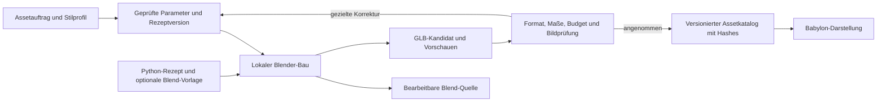

# NEON CONTRACT – Agentengesteuerte Low-Poly-Asset-Pipeline

Stand: 21.10.2026 · **Recherche und Planungsvorschlag, keine Implementierungsfreigabe.**

**Bildreferenz-Versuch vom 22.10.2026:** Ein bereitgestelltes Fahrzeugbild dient dem lokalen [Python-/Blender-Piloten](IMAGE_REFERENCE_PILOT.md). Manuelle Kontur-/Punktzuordnungen, berechnete Bildkanten und bedingte Kameraschätzung ergeben einen Low-Poly-Entwurf mit GLB-/Blend-Lieferung und Ansichtsvergleich. Maßstab und verdeckte Form bleiben Annahmen; das annotierte Rezept ist auf diesen Versuch zugeschnitten.

**Formalisierung vom 22.10.2026:** Der [Familienvertrag](ASSET_FAMILIES.md) und der [Skill `asset-families`](../.agents/skills/asset-families/SKILL.md) beschreiben gemeinsame Geometriebasen, getrennte Erscheinungsprofile und Instanzdaten für verschiedene lokale Agenten. Der Laufzeitumbau des Terminalpiloten ist offen; siehe [0023](decisions/0023-wiederverwendbare-assetfamilien.md).

**Separater Produktionspilot vom 22.10.2026:** Die beauftragte [Terminal-Familie](TERMINAL_PILOT.md) setzt einen parametrischen JSON-/Blender-/NumPy-Weg für 18 technische Props um. GLB, Blend, Rastergrafik, Hash-Cache, Vorschau und unabhängige Prüfungen sind vorhanden; siehe [0022](decisions/0022-parametrische-terminal-familie.md). Der Auftrag erweitert weder Missionsregeln noch die allgemeine Assetabnahme.

**Begrenzter Folgeauftrag vom 22.10.2026:** Ein lokaler Prüfer analysiert den vom Nutzer bereitgestellten Assetordner mit Hash-Cache, Rig-/Clipvergleich und Kontaktbögen. Quellen bleiben unverändert. Dieser beauftragte Analyseschritt ist unter [ASSET_INSPECTION.md](ASSET_INSPECTION.md) dokumentiert und keine allgemeine Produktions- oder Spielintegrationsfreigabe.

**Folgeauftrag zum Figuren-Teil:** Der später am selben Tag ausdrücklich beauftragte TypeScript-Character-Creator wird separat unter [CHARACTER_CREATOR.md](CHARACTER_CREATOR.md) und [0016](decisions/0016-typescript-character-creator.md) umgesetzt. Das ist keine pauschale Freigabe der hier geplanten gesamten Asset-Pipeline. Für diesen Pilot ergänzen TypeScript-Rezept und JSON die Blend-Quellenregel.

Zuordnung: GEN-10, GEN-02G, GEN-11, MOD-10/15; Platzhalterbezug AP-04/14. Ergänzt [0007](decisions/0007-babylon-taktikansicht.md) und [0013](decisions/0013-isometrische-fortsetzung.md). Die vorgeschlagene Richtung steht in [0015](decisions/0015-agentengesteuerte-asset-pipeline.md). v0.1 und die offene M7-Abnahme werden dadurch nicht erweitert.

## 1. Empfehlung

**Blender als Produktionskern, Python-Rezepte mit begrenzten Parametern als Bauplan, vorhandene Coding-Agenten als Bediener.** Lokale Blender-Hintergrundprozesse bauen und prüfen die Assets. Für interaktive Arbeit kommt das bestehende **MCP for Blender** infrage. Aus **Blender Agent Skills** werden nach Prüfung passende Export-, Vorschau- und QA-Bausteine übernommen. Ein neuer allgemeiner Blender-MCP-Server ist nicht erforderlich.

Der Agent entwickelt einmal ein brauchbares Rezept, betrachtet dessen Ergebnis und korrigiert es. Danach erzeugt dasselbe Rezept kontrollierte Varianten. So entstehen zusammenpassende Assetfamilien statt jedes Mal ein vollständig neu erfundenes Modell. Mit Python lassen sich die ersten Familien ausreichend ausdrücken; Geometry Nodes werden erst für tatsächlich hilfreiche wiederkehrende Formen ergänzt.

**Kiln ist die beste gefundene Alternative für einen eigenen kleinen Vergleich.** Es passt bereits sehr gut zu agentengesteuerter, parametrisierter Produktion. Die editierbare Quelle ist dort JavaScript/TypeScript. Für dieses Projekt bleibt Blend jedoch die vereinbarte Quelle. Ein nachträglicher GLB-Import in Blender stellt Kilns ursprünglichen parametrischen Bauplan nicht als Blender-Rezept wieder her. Deshalb Kiln zunächst prüfen, nicht gleichzeitig einen zweiten Produktionskern einführen.

Zusätzliche Abos, bezahlte Modell-APIs und Cloud-3D-Generatoren sind keine Voraussetzung. Die Planung setzt voraus, dass **einer** der vorhandenen Coding-Agenten genutzt wird; es müssen nicht alle drei bezahlt oder gleichzeitig betrieben werden. Dessen bestehende Kontingente und die lokale Rechenzeit bleiben Verbrauchskosten. Lokale Geometrieerzeugung benötigt keinen weiteren LLM-API-Schlüssel und kein lokales generatives 3D-Modell.

## 2. Recherche vorhandener Repos

Gesucht wurden Blender-MCP-Brücken, Agenten-CLI/Skills, prozedurale Low-Poly-Werkzeuge und lokale Text-/Bild-zu-3D-Pipelines. Geprüft wurden die unten verlinkten Primärquellen, Repository-Metadaten und bei den Kernkandidaten ausgewählte Implementierungen. Ein öffentlicher Suchtreffer oder eine README-Aussage ist kein eigener Funktionsnachweis. Bewertungen und Auswahl sind unsere Ableitung daraus.

### Direkt geeignete Bausteine

**[ahujasid/mcp-for-blender](https://github.com/ahujasid/mcp-for-blender)**, früher `blender-mcp` — MIT. Nennt Codex, Claude Code und Cursor; verbindet einen lokalen MCP-Prozess mit einem Blender-Addon. Der gelesene Server enthält Python-Ausführung sowie Ansichts- und Szenenabfragen. Lokale Modellierung ist von optionalen Premium-Generatoren getrennt. Kandidat für interaktive Produktion, kein fertiger NEON-Assetvertrag. Das Hauptprojekt ist am 20.10.2026 aktualisiert worden. Die gelesene Paketdefinition nennt 2.2.2; Registry-Verfügbarkeit und passende Addon-Version sind bei Einrichtung gesondert zu prüfen. [README](https://github.com/ahujasid/mcp-for-blender/blob/main/README.md), [Server](https://github.com/ahujasid/mcp-for-blender/blob/main/src/blender_mcp/server.py), [Paketdefinition](https://github.com/ahujasid/mcp-for-blender/blob/main/pyproject.toml), [Lizenz](https://github.com/ahujasid/mcp-for-blender/blob/main/LICENSE).

**[EL4CTEO/blender-skills](https://github.com/EL4CTEO/blender-skills)** — MIT. Bündelt Agenten-Workflows für Modellierung, Geometry Nodes, Rigging, Export und Qualitätsprüfung und nennt alle drei gewünschten Agenten. Die README verlangt Blender 5.2+. Die gelesenen Skripte bieten GLB-Export sowie Prüfungen etwa für Normalen, Gewichte und überlagerte Flächen. Übernahme kleiner passender Teile ist sinnvoller als ein vollständiger ungeprüfter Skill-Import. Das Preset `web` aktiviert WebP und Meshopt; für den ersten NEON-Export eignet sich das einfachere `gltf`-Preset als Ausgangspunkt. [README](https://github.com/EL4CTEO/blender-skills/blob/main/README.md), [Exporter](https://github.com/EL4CTEO/blender-skills/blob/main/skills/blender-export-pipelines/scripts/export_asset.py), [QA](https://github.com/EL4CTEO/blender-skills/blob/main/skills/blender-asset-qa/scripts/qa_check.py), [Lizenz](https://github.com/EL4CTEO/blender-skills/blob/main/LICENSE).

**[KhronosGroup/glTF-Validator](https://github.com/KhronosGroup/glTF-Validator)** — Apache-2.0. Unabhängige Formatprüfung für den fertigen Export, auch als Node-Paket verfügbar. Als Werkzeugabhängigkeit einplanen. Er prüft glTF-Konformität; Spielmaßstab, gute Silhouette und verständliche Animation sind zusätzliche Projektprüfungen. [README](https://github.com/KhronosGroup/glTF-Validator/blob/main/README.md), [Lizenz](https://github.com/KhronosGroup/glTF-Validator/blob/main/LICENSE).

### Ernsthafte Alternative

**[instruktlabs/kiln](https://github.com/instruktlabs/kiln)** — MIT. Lokale CLI, MCP und JS/TS-Geometrie mit editierbaren Revisionen, gerenderten Ansichten, Strukturprüfung und GLB-Export. Die Dokumentation nennt Codex, Claude und Cursor-Agent; für lokale Werkzeuge ist kein eigener Modell-API-Schlüssel erforderlich. CPU-Rendering ist möglich, materialgetreue Ansichten haben zusätzliche lokale Anforderungen. Das ist der vollständigste gefundene direkte Ansatz ohne Blender als Kern. Vor Übernahme Windows-Paket und tatsächliche Bildqualität prüfen. Assetpacks haben eigene Lizenzen. [README](https://github.com/instruktlabs/kiln/blob/main/README.md), [Installation und Plattformgrenzen](https://github.com/instruktlabs/kiln/blob/main/docs/install.md), [Lizenz](https://github.com/instruktlabs/kiln/blob/main/LICENSE).

### Nützliche Spezialwerkzeuge, zunächst optional

**[mojo3325/rendex](https://github.com/mojo3325/rendex)** — GPL-3.0-or-later laut README. Erstellt acht orthografische Ansichten einschließlich technischer Oberflächen. Interessant als bestehende Vorschauhilfe. Der erste Slice braucht vor allem Ansichten aus unserer Spielkamera; diese muss ein Adapter ergänzen. [README](https://github.com/mojo3325/rendex/blob/main/README.md).

**[mojo3325/paxel](https://github.com/mojo3325/paxel)** — GPL-3.0-or-later laut README. Palette und kompakter Atlas für Low-Poly-Texturen. Interessant für spätere manuelle Bereinigung und gemeinsame Farbpaletten, nicht erforderlich für zunächst einfache exportierbare Materialien. [README](https://github.com/mojo3325/paxel/blob/main/README.md).

### Für diesen Einstieg zurückgestellt

**[mojo3325/luarch](https://github.com/mojo3325/luarch)** — GPL-3.0-or-later. Parametrisierte taktische Low-Poly-Gebäude mit Varianten und Validierung; Export ist auf FBX/RBXMX und Roblox ausgerichtet. Ideen für editierbare Modulvarianten sind interessant. Sein Gebäudegrundriss würde aber mit unserem vorhandenen semantischen Generator konkurrieren. Daher keine Übernahme der Layoutlogik. [README](https://github.com/mojo3325/luarch/blob/main/README.md).

**[princeton-vl/procfunc](https://github.com/princeton-vl/procfunc)** — BSD-3-Clause laut Repository-Metadaten. Funktionale Blender-Abstraktionen und Geometry-Nodes-Transpiler. Die aktuelle README bindet an `bpy==4.2.0` und Python 3.11 und nennt instabile Schnittstellen vor 1.0. Damit kein passender Basiskern für den vorgeschlagenen Blender-5.2-Workflow. [README](https://github.com/princeton-vl/procfunc/blob/main/README.md), [Lizenz](https://github.com/princeton-vl/procfunc/blob/main/LICENSE).

**[princeton-vl/infinigen](https://github.com/princeton-vl/infinigen)** — BSD-3-Clause laut Repository-Metadaten. Umfangreiche prozedurale Szenen und Innenräume mit fotorealistischem Schwerpunkt. Referenz für Generatorarchitektur; für unser kleines stilisiertes Modulkit voraussichtlich zu großer Integrationsumfang. [README](https://github.com/princeton-vl/infinigen/blob/main/README.md), [Lizenz](https://github.com/princeton-vl/infinigen/blob/main/LICENSE).

**[zorrobyte/asset-studio](https://github.com/zorrobyte/asset-studio)** — 0BSD für den Pipelinecode. Vollständig lokaler Text-zu-3D-Ansatz mit CLI/MCP, Qwen-Image, Pixal3D/TRELLIS.2 und Blender-Nachbearbeitung. Die Referenzinstallation setzt Windows 11, RTX 5090 mit 32 GB, Docker/WSL2 und ungefähr 120 GB freien Speicher voraus. Kein Abo nötig, aber erhebliche Hardware- und Gewichtsanforderungen. Modelllizenzen sind separat; eine angebotene Bildmodellvariante ist ausdrücklich nicht kommerziell. Ohne Prüfung der vorhandenen Hardware kein Basiskandidat. Die veröffentlichten Laufzeiten sind Messungen des Autors, keine Werte dieses Projekts. [README](https://github.com/zorrobyte/asset-studio/blob/master/README.md), [Lizenz](https://github.com/zorrobyte/asset-studio/blob/master/LICENSE).

### Recherchestand festhalten

Am 21.10.2026 gelesene Hauptstände der Kernkandidaten:

- MCP for Blender: [`5a3618fccb2d982d0dd61e7a1879912c3100073b`](https://github.com/ahujasid/mcp-for-blender/tree/5a3618fccb2d982d0dd61e7a1879912c3100073b).
- Blender Agent Skills: [`71d031dab8bc6729504d11a78cbe91945401045f`](https://github.com/EL4CTEO/blender-skills/tree/71d031dab8bc6729504d11a78cbe91945401045f).
- Kiln: [`815206d57b551bcdf70cee813835bc1f47c38a32`](https://github.com/instruktlabs/kiln/tree/815206d57b551bcdf70cee813835bc1f47c38a32).
- glTF-Validator: [`602c54043ba66856b2e68c40fdf2bced975cdb8a`](https://github.com/KhronosGroup/glTF-Validator/tree/602c54043ba66856b2e68c40fdf2bced975cdb8a).

Das sind Rechercheanker, keine getestete Paketkombination. Bei Umsetzung genaue Blender-Patchversion, Addon-/MCP-Paar, übernommene Skripte und Lockfiles gemeinsam qualifizieren. Drittanbieter-Code und dessen Nutzungsangaben getrennt von den erzeugten Assets erfassen.

## 3. Zugang durch Codex, Claude Code und Cursor

Gemeinsamer Nenner ist **lokaler Shellzugriff**; optional kommt **MCP über stdio** hinzu. Der Agent muss Blender und Projektdateien auf derselben Arbeitsmaschine erreichen können. Eine Cloud-Sitzung hat nicht allein durch die MCP-Konfiguration Zugriff auf das lokale Blender.

- **Codex:** lokaler stdio-MCP-Prozess mit `command`, `args`, `env` und bei Bedarf `cwd`. Die offizielle OpenAI-Dokumentation beschreibt diesen Zugang. [MCP](https://learn.chatgpt.com/docs/extend/mcp?surface=cli).
- **Claude Code:** lokaler Server über `claude mcp add --transport stdio <name> -- <command> ...`; projektbezogene Konfiguration ist möglich. [MCP](https://code.claude.com/docs/en/mcp).
- **Cursor:** lokale stdio-Server über `.cursor/mcp.json`; dieselbe Konfiguration wird auch von der CLI verwendet. [MCP](https://cursor.com/docs/mcp), [CLI](https://cursor.com/docs/cli/mcp).

Die Projektfunktionen und Asset-Spezifikationen bleiben bei einem Agentenwechsel identisch. Nur die Startkonfiguration unterscheidet sich. Kein Agenten-SDK und keine zusätzliche API-Abrechnung als Pipelinevoraussetzung.

Für MCP for Blender: ein aktiver schreibender Client pro Blender-Instanz, Verbindung nur lokal, optionale Generator-/Downloaddienste unbenutzt. `DISABLE_TELEMETRY=true` für den Werkzeugprozess einplanen. Das Addon führt Python aus und ist keine Sandbox; eine Schema-Prüfung der Assetparameter ersetzt keine Prozessisolation. Diese Einstellungen und Grenzen sind in der [Projekt-README](https://github.com/ahujasid/mcp-for-blender/blob/main/README.md#environment-variables) beschrieben.

**Einrichtungstest je Client:** Werkzeug entdecken → Testobjekt erzeugen → lokale Vorschau tatsächlich ansehen → einen Parameter ändern → Blend und GLB speichern → exportierte Maße prüfen. Die Unterstützung ist dokumentiert; dieser Test wurde hier für keinen Client ausgeführt. Bildfeedback muss im jeweiligen Client funktionieren, sonst bleibt die visuelle Prüfung ausdrücklich menschlich.

## 4. Datenfluss und Zuständigkeiten



1. **Auftrag:** Objektfamilie, Nutzung, Referenzmaße, sichtbare Merkmale, Zielkamera und Kostenbudget festhalten. Der Agent darf Entwürfe vorschlagen; bestehende Stilregeln werden als versioniertes Profil gespeichert.
2. **Parameter prüfen:** JSON-Schema mit erlaubten Familien, Wertebereichen, Paletten und Größen. Unbekannte Felder, ungültige Maße, zu große Wiederholungszahlen und Pfade außerhalb des Asset-Arbeitsbereichs ablehnen. Keine ausführbaren Ausdrücke in JSON.
3. **Bauen:** frischer Blender-Prozess oder eigene Produktionsdatei. Python-Rezept erzeugt benannte Teile aus einfachen Meshes und wenigen Modifiern. Geometrie, Material und Präsentationsszene sind getrennt. Ein wiederholter Auftrag hängt nicht vom zufälligen Zustand der zuletzt offenen Szene ab.
4. **Prüfen und ansehen:** technische Kennzahlen, neutrale Mehrfachansicht und Spielkamera-Bilder erzeugen. Der Agent benennt konkrete Bildfehler und ändert zugehörige Parameter oder das Rezept. Höchstens drei Korrekturrunden pro Auftrag; dann Kandidat mit offenem Problem ausgeben. Harte Fehler dürfen nicht durch eine gute Bildbewertung aufgehoben werden.
5. **Exportieren:** aus einer Exportkopie Modifier auswerten, Instanzen nötigenfalls realisieren und erlaubte Meshes/Clips exportieren. Die bearbeitbare Quelle bleibt bestehen. Ein prozeduraler Shader wird vor Export in unterstützte einfache Materialien oder Texturen übersetzt.
6. **Übernehmen:** nur angenommene Dateien, Manifest und Hashes in den Laufzeitkatalog kopieren. Ein fehlgeschlagener Neubau lässt die bisherige angenommene Revision bestehen. Die Mission lädt fertige Dateien und stabile IDs; sie startet weder Blender noch einen Agenten.

Ein Auftragsstatus umfasst `queued`, `building`, `review`, `rejected`, `accepted`, `failed` und `cancelled`. Ein kleiner lokaler Runner genügt; kein neuer Webdienst oder Nachrichtenbroker im ersten Slice. Job-ID, eigene Ausgabeordner und serielle Schreibzugriffe vermeiden vermischte Ergebnisse. Abbruch beendet nur den eigenen Produktionsprozess.

## 5. Parametrisierung und Stil

**Veränderlich:** Abmessungen innerhalb freigegebener Hüllen, Segmentzahl, Paneelaufteilung, Verstrebungen, begrenzte abgeschrägte Kanten, Palettenplätze, kleine Emissionsflächen und kosmetische Gebrauchsspuren. Namen und Beschriftung zuerst als einfache Formen; keine kaum lesbaren generierten Schrifttexturen.

**Fest pro Familie:** Montagepunkte, Kontaktfläche, Pivot, Orientierung, erlaubte Animationen, Materialvertrag und Bezug zur logischen Objektrolle. Ein Varianten-Seed verwendet nur einen eigenen kosmetischen RNG. Er darf weder Raumgeometrie noch Kampf-RNG verändern.

Stilvorschlag: große erkennbare Formen, wenige Flächenfarben, zurückhaltende Fugen, gut sichtbare Vorderseite, kontrollierte Neonakzente. Die bestehenden Konzerne KASANE, CONCORD, PARALLAX und VERDANT können später Profile erhalten. Der erste Test verwendet neutral und höchstens ein Konzernprofil; kein vollständiger neuer Artkatalog.

Beispiel einer **erst noch zu implementierenden** Spezifikation; Zahlen sind Startvorschläge auf Basis des vorhandenen Terminal-Platzhalters:

```json
{
  "schemaVersion": 1,
  "assetId": "prop.terminal.kasane.a",
  "family": "terminal",
  "recipeVersion": "terminal-1",
  "styleProfile": "kasane-1",
  "cosmeticSeed": 1842,
  "dimensionsWorldUnits": { "width": 0.46, "depth": 0.46, "height": 0.55 },
  "anchor": "bottom-center",
  "parameters": { "screenTiltDegrees": 15, "panelCount": 2, "wear": 0 },
  "limits": { "triangles": 1000, "materials": 2 },
  "previewProfile": "neon-iso-1"
}
```

Schema, Rezept und Stilprofil erhalten getrennte Versionen. Die Spezifikation enthält **keine** Trefferpunkte, Deckungswirkung, Sichtblockade oder Wegfindungsregeln. Ein Assetkatalog kann eine Darstellungsrolle referenzieren; der Missionsinhalt legt deren Spielwirkung unabhängig fest.

## 6. Technischer Assetvertrag

**Format und Versionen:** Blend als Quelle, GLB als Lieferformat. Vorschlag für den Pilot ist Blender **5.2 LTS**, damit die untersuchten Skills denselben API-Zweig nutzen. Das ist keine Aussage über die installierte Blender-Version. Exakte Patch- und Exporterversion nach Einrichtung festhalten. Basisexport zunächst ohne Draco, Meshopt, KTX2 und spezielle Shader. Erweiterungen nur nach Nachweis im tatsächlichen Babylon-Loader.

**Raster und Maße:** eine Rasterzelle bleibt 1,0 Welteinheiten. Das ist eine Spielkonvention, keine zugesicherte reale Meterabbildung. Der Bestand in `apps/client/src/iso/mountIsoBoard.ts` verwendet etwa 1,05 Einheiten hohe Figuren, 1,0 hohe Wandblöcke und 0,52 hohe Deckung. Erst Referenzszene und Proportionen festhalten, dann modellieren; kein heimlicher Wechsel zu realistischen 1,8-Meter-Figuren. Statische Exportobjekte haben angewandten Maßstab 1,0. Bei Armaturen den geprüften Exportweg nutzen, nicht nachträglich blind Transformationswerte anwenden.

**Achsen und Anker:** Vorschlag für die Quelle: Blender Z nach oben, lokale Vorderseite nach −Y; Export als glTF Y-up. Die Babylon-Abbildung mit asymmetrischem Nordpfeil, 1×1-Referenzfläche und markierter Vorderseite nachweisen, einschließlich aller vier Kameradrehungen. Keine doppelte Achsenkorrektur im Client. Bodenmitte als Standardpivot; Türscharniere, Wandsockel und Figuren-Wurzel als familienabhängige Ausnahme ausdrücklich dokumentieren. Verbindungsanker müssen nach 90-Grad-Drehung am Raster einrasten.

**Geometrie und Material:** bewusste kantige oder kontrolliert geglättete Normalen; keine zufälligen Boolean-Reste. Außenhülle, Clipraum und dekorativer Überstand werden geprüft. Eine gemeinsame kleine Materialpalette bzw. später ein Atlas begrenzt Materialwechsel. Kleine statische Props starten mit höchstens 1.000 Dreiecken und zwei Materialgruppen, größere Einzelmodule mit 3.000; Figuren zunächst mit 5.000 und vier Gruppen. Das sind vorgeschlagene Assetgrenzen, **keine gemessenen Browser-Performanceziele**. Gezählt wird nach Modifiern und Export. Meshanzahl, Draw Calls, Texturen und sichtbare Instanzzahl zusätzlich messen.

**Animationen:** Figuren brauchen einen gemeinsamen überprüften Deformationsrig und die Clips `idle`, `walk`, `crouch`, `shoot`, `reload`, `hit`, `death`. Der erste Figurenauftrag erstellt einen Master, danach Körper-/Ausrüstungsvarianten mit demselben Rig. Keine unabhängige Neugenerierung des Skeletts je Variante. Bewegung zunächst am Ort; Root Motion verschiebt keine logische Figur. Exportierte Clipnamen, Dauer, Gewichte, Boden-/Fußkontakt und Ausrüstungspunkte prüfen. Das Vorhandensein eines gleichnamigen Clips beweist noch keine brauchbare Bewegung.

**Spielwirkung:** weder dekorative Kollisionshüllen noch Mesh-Picking definieren Bewegung, Sicht oder Deckung. Auswahl bleibt über stabile Einheiten-/Zellbezüge möglich. Verdeckende Wanddarstellung und Unbekannt-/Sichtbar-Zustände sind Aufgaben des bestehenden Darstellungsadapters. Keine Mesh-Physik in `packages/sim`.

## 7. Geplante Dateien und Wiederverwendung

Alle folgenden Pfade sind **Zielstruktur**, in diesem Auftrag nicht angelegt:

```text
assets/specs/                 geprüfte Produktionsaufträge
assets/styles/                versionierte Paletten und Formvorgaben
assets/source/                angenommene Blend-Quellen und Texturen
assets/manifests/             Herkunft, Versionen und Lieferdatei-Hashes
assets/work/<job-id>/          getrennte Kandidaten, Berichte und Vorschauen
tools/assets/                 kleiner Runner, Rezepte, Export-/Prüfadapter
tools/assets/vendor/          nur konkret übernommene Drittanbieter-Bausteine
apps/client/public/assets/    angenommene GLBs für die Darstellung
```

Ein kleiner Runner auf der vorhandenen Node-Laufzeit startet Blender mit direktem Prozessaufruf und argumentgetrennter Übergabe. Python-Rezepte laufen in Blender; eine zusätzliche systemweite Python-Installation ist dafür keine Voraussetzung. MCP besitzt seine separat festgelegte Python-Umgebung. Blender-Pfad explizit konfigurieren, Arbeitsverzeichnis und Ausgabepfade absolut auflösen. Keine Abhängigkeiten aus Nachbarprojekten.

Geplante CLI-Oberfläche: `doctor`, `build <spec>`, `review <job>`, `validate <job>`, `accept <job>`. Das sind keine heute verfügbaren Befehle. `doctor` prüft Versionen, Schreibbereich und Exportfähigkeit. Der Build muss bei Python-Fehlern einen Fehlerstatus liefern; Blender dokumentiert dafür `--python-exit-code`. [Blender-Kommandozeile](https://docs.blender.org/manual/id/5.2/advanced/command_line/arguments.html).

Manifestinhalt: Asset-ID und Revision, Spezifikations-/Rezept-/Stilhash, kosmetischer Seed, Blender-/Exporter-/Werkzeugversion, verwendeter Agent soweit bekannt, Herkunft und Nutzungsangaben je Vorlage/Textur/Codebestandteil, gemessene Exportmaße, Dreiecke/Materialien/Meshes, Clips, Prüfergebnis und SHA-256 jeder Lieferdatei. Keine Zugangsdaten. Übernommene Vorlagen haben eigene Rechte; die Lizenz einer Brücke ist keine Lizenz für heruntergeladene Modelle.

Ein Build-Schlüssel aus kanonischer Spezifikation, Rezept-/Vorlagen-/Texturhashes und Werkzeugversionen erlaubt Wiederverwendung. Der Agententext ist nicht der reproduzierbare Bauplan. Gleicher Prompt garantiert weder gleiche Geometrie noch gleiche GLB-Bytes. Für Releases werden die fertigen Dateien eingefroren; Wiederaufbau prüft mindestens Maße, Topologiekennzahlen und Referenzbilder. Dateihashes identifizieren die tatsächlich ausgelieferten Dateien.

## 8. Qualitätsgates

**Automatisch, vor Annahme:**

- Spezifikation gültig; keine doppelten IDs, unzulässigen Dateipfade oder fehlenden Quellen-/Nutzungsangaben.
- Blend speicherbar, GLB unabhängig ladbar; glTF-Validator ohne Fehler. Warnungen einzeln begründen, nicht pauschal ignorieren.
- Bounding Box, Pivot, Anker und Orientierung innerhalb des Familienvertrags; statischer Maßstab 1,0; keine ungültigen Zahlen, entarteten Dreiecke oder fehlenden Materialien/Dateien.
- Dreiecks-, Material- und Texturbudget nach Export eingehalten. Offene Flächen, getrennte Teile und UV-Überlappung nach Profil beurteilen: ein bewusst offener Wandrücken oder ein Paletten-UV ist nicht automatisch ein Fehler.
- Varianten einer Rolle behalten Hüllmaße und Befestigungen. Figuren zusätzlich: alle Pflichtclips, gültige Gewichte und gemeinsamer Rigvertrag; Türen: Pivot und Bewegungsraum.

**Visuell:** neutrale Mehrfachansicht plus 45-Grad-Spielkamera in vier Drehstellungen, bei vorgesehenem Zoom. Terminal, Tür, niedrige Deckung und Gegnerrolle müssen anhand der Form lesbar sein. Palette auch bei gedimmter Darstellung, Auswahlmarkierung und kleinem Bildschirm beurteilen. Figuren in Bewegung ansehen; ein einzelnes schönes Vorschaubild reicht nicht.

**Im Projekt:** Eine spätere Integrationsaufgabe lädt dieselben akzeptierten Assets in `?stueck=sicht` und in der Generatorwerkstatt. `?stueck=raster` bleibt gemäß 0013 unverändert. Der Bestand erzeugt derzeit Box-Meshes; ein GLB-Katalog und die Ladeanbindung müssen noch ergänzt werden. Der spätere Figurenpilot sperrt `@babylonjs/core`, `@babylonjs/loaders` und `@babylonjs/serializers` gemeinsam auf 9.31.2 und prüft den Export separat; das belegt noch keine Spielintegration.

Integration prüft fehlendes Asset mit sichtbarem Rückfall, vier Kamerawinkel, Picking, Sichtfilter und Neuladen aus Snapshot ohne alte Animation. Ein späterer Mehrclient-/Reconnect-Test bestätigt dieselbe angenommene Assetrevision und korrekten Zustand. Visueller Variantenwechsel verändert keine Simulationsereignisse oder logischen Kartenwerte. Der reine Produktionspilot erfindet hierfür keine bereits bestandenen Spieltests.

## 9. Kleine, einzeln beauftragbare Umsetzungsschritte

1. **Zugang und Referenzvertrag.** Blender-Version und Pfad feststellen, einen Hintergrundbau mit Blend/GLB/PNG nachweisen. Optional MCP in einer eigenen Produktionsszene einrichten. Das Einrichtungsszenario aus Abschnitt 3 je gewünschtem Client nachweisen. Ergebnis: tatsächlicher Werkzeugstand und Maße-/Achsenreferenz. Keine Assetserie.
2. **Ein parametrisierter Prop.** Terminal mit einer Basis und zwei gezielten Varianten, ohne Texturgenerierung. Export, Manifest und harte Prüfungen. Einen ungültigen Parameter und einen absichtlich fehlerhaften Export nachweislich ablehnen; gültigen Altstand behalten. Ergebnis: ein durchgehender Produktionsweg.
3. **Kleines Umgebungskit.** Boden, Wand und niedrige Deckung ergänzen; zusammen mit dem Terminal zunächst vier Familien. Neutrales Profil, optional KASANE. Nähte, Anker, gemeinsame Hüllmaße und Kamera-Lesbarkeit prüfen. Erst bei brauchbarem Ergebnis weitere Büro-/Labor-/Lagerrequisiten.
4. **Darstellung integrieren.** GLB-Katalog und Loader an die bestehenden Adapter anbinden, zuerst Generatorwerkstatt und `?stueck=sicht`. Ladefehler, Sichtfilter, Snapshot und Reconnect prüfen. Keine Änderung am Regelsystem oder Gebäudegrundriss.
5. **Geriggter Figurenmaster.** Eine Figur mit sieben Pflichtclips herstellen und tatsächlich in Bewegung beurteilen. Erst dann Crew-/Wachvarianten, Waffen-/Ausrüstungspunkte und weitere Rollen. Das ist eine eigene Abnahme; die erfolgreiche Prop-Pipeline beweist sie nicht.

**Abdeckung des bestehenden GEN-10-Vertrags:** Nach erfolgreichem Umgebungspilot sind über dieselbe Strecke auch Tür, Treppe und Extraktionsdarstellung zu produzieren; die Figurenstufe liefert Crew und Gegner. Die Tür braucht einen geprüften Öffnungszustand und Pivot. Die Treppe ist zunächst ein geprüftes Darstellungsmodul und führt keine spielbare Höhenwechselregel ein. Vier Pilotfamilien allein erfüllen den vollständigen Platzhaltervertrag nicht.

**Optionaler Vergleich vor Schritt 2:** dasselbe Terminal-Briefing mit Blender und lokalem Kiln bauen. Tatsächliche Einrichtungsprobleme, Anzahl nötiger Korrekturen, Änderbarkeit, gemessene Budgets und Spielkamera-Bilder vergleichen. Keine vorab erfundenen Qualitäts- oder Zeitwerte. Kiln nur als Hauptweg übernehmen, wenn der Nutzen den zusätzlichen Quellformatvertrag rechtfertigt; dann 0007 ausdrücklich ergänzen.

Nicht-Ziele des Einstiegs: lokales Diffusionsmodell, bezahlte Text-/Bild-zu-3D-Dienste, automatische Retopologie beliebiger Figuren, große Bibliothek, komplette Gebäudeerzeugung, WFC, Kampagneninhalte oder eine neue allgemeine Agentenplattform. Ein erster brauchbarer Prop erteilt keine Freigabe für diese Erweiterungen.

## 10. Tatsächlicher Nachweis dieses Planungsauftrags

Erfolgt: Projektvorgaben und relevante Mindestverträge gelesen; Tag-Index abgefragt; zehn Repos anhand ihrer Primärquellen eingeordnet; ausgewählte MCP-, Export- und QA-Implementierungen sowie Lizenzen der Kernkandidaten gelesen; vorhandene Babylon-Ansicht und Client-Paketdatei geprüft. Der Arbeitsordner ist derzeit kein Git-Repository; deshalb ist kein Git-Diff-Nachweis verfügbar.

Dokumentprüfung: 75 lokale Verweise in den bearbeiteten Dokumenten haben vorhandene Ziele; das JSON-Beispiel ist syntaktisch lesbar. Der Tag-Index wurde einschließlich Vorschlag 0015 neu aufgebaut.

Offen: keine Installation, keine MCP-Einrichtung, kein Blender-Bau, kein erzeugtes Asset, kein visueller Qualitätsvergleich und kein Client-Kompatibilitätstest. Hardwareeignung für neuronale Modelle wurde nicht geprüft. Die Pipeline ist geplant, nicht implementiert. Menschliche Art- und Spielabnahmen bleiben offen.
