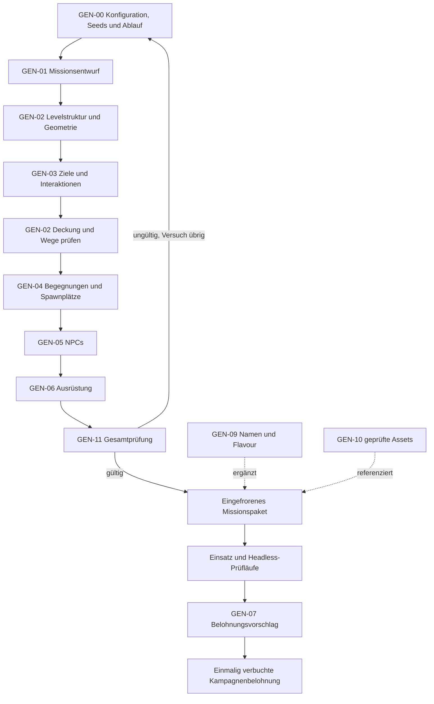

# NEON CONTRACT – Modulare Generatoren

Stand: 21.10.2026 · Status: Planung mit einem beauftragten Gebäude-Prototyp. `packages/generator` und die Werkstatt implementieren Teile von GEN-00/02/03/04/11; M7 ist noch nicht abgeschlossen. Umfang und Start: [GEBAEUDEGENERATOR.md](GEBAEUDEGENERATOR.md), [0009](decisions/0009-semantischer-gebaeudegenerator.md).

Bezug: [MOD-15 im Modulplan](MODULE.md), [Entwickleransicht S23](SCREENS.md), [Arbeitspakete](ARBEITSPAKETE.md).

Die erforderliche Basis für v0.1 und das Minimum bei späterer Einführung jedes Generators stehen in [MVP_GENERATOREN.md](MVP_GENERATOREN.md). Die allgemeine MVP-Abgrenzung steht in [MVP.md](MVP.md).

## 1. Zweck und Ausbaufolge

Generatoren sollen neue Inhalte innerhalb bekannter Spielregeln zusammensetzen. Sie ersetzen weder den Regelkern noch ein von Menschen geprüftes Missionsdesign.

**v0.1:** handgebaute Karte, zwei fest definierte Gegnertypen, zwei Waffen-Presets. Benötigt werden Loader, einfache Instanziierung und Validatoren. Ein NPC aus einer Vorlage ist bereits modular erzeugbar, ohne zufällige Skills oder einen vollständigen Levelgenerator einzuführen.

**v0.2:** dieselbe Grundkarte mit geprüften Varianten für 4/6/8 Runner, drei Gegnertypen, Alarmwellen und ausgewählten Loadouts. Seedbare Auswahl innerhalb dieser Vorlagen ist möglich; freie Kartenerzeugung bleibt außerhalb der Abnahme.

**M7:** hierarchische Erzeugung nach [0008](decisions/0008-hierarchischer-missionsgenerator.md). Zuerst Missionsmuster, dann Raumgraph und taktisches Layout, dann Begegnungen, zuletzt Darstellung. Die erste Stufe ist ein Datenraub in einem Gebäude mit 8 bis 15 Räumen. Straßen, mehrere Missionsfamilien, WFC und Shape Grammars folgen erst, wenn die vorherige Stufe brauchbare Missionen liefert. Stadtangebote und Wirtschaft benötigen zusätzlich die Kampagnensysteme.

**Generative KI für Text/Bilder** ist eine eigene Inhaltserstellung vor der Veröffentlichung. Im laufenden Spiel sind die Generatoren deterministische Programme mit lokalen Daten; externe Modellantworten dürfen keine Trefferwerte, Itemeffekte oder Missionsregeln festlegen.

## 2. Gemeinsamer Vertrag

**Eingabe:** Root-Seed, Generator-ID/-Version, stabile Instanz-ID, relevante Content-Versionen, Parameter und Randbedingungen.

**Ausgabe:** erzeugtes Datenobjekt, Metadaten, benutzte Unter-Seeds und Validierungsbericht; bei Fehlschlag ein erklärter Fehler statt halbfertiger Inhalte.

**Orchestrierung:** Jeder Generator bekommt einen benannten Zufallsstrom. Der Seed wird aus Root-Seed, Generator-ID/-Version, Instanz-ID und Versuchsnummer abgeleitet. Ein NPC-Name und dessen Kampfwerte verwenden unterschiedliche Unterströme. Die bloße Ergänzung eines kosmetischen Generators darf Kampfwerte nicht verschieben.

Metadaten nennen den vollständigen Content-Hash; Zufallsströme hängen nur von explizit relevanten Versionen/Inputs ab. Die Ableitungsfunktion und Serialisierung werden versioniert. Identische Eingaben müssen identische normalisierte Ergebnisse ergeben.

**Begrenzung:** vorgeschlagen höchstens zehn Gesamtversuche pro Missionspaket. Ein Versuch verwendet seinen dokumentierten Unter-Seed. Keine unbegrenzte Suche und keine an Rechnergeschwindigkeit geknüpfte Entscheidung.

**Rückfall:** Nach ausgeschöpftem Budget wird eine zur Spielerzahl passende, geprüfte Vorlage verwendet oder ein klarer Erzeugungsfehler zurückgegeben. Der Rückfall wird im Entwicklungsbericht markiert und nicht als gelungenes Zufallsergebnis gezählt.

**Einfrieren:** Ein akzeptiertes Missionspaket wird vor dem Start gespeichert. Der Start verwendet exakt dieses Paket. Reconnect, Hotjoin und Clientneuladen führen keine erneute Generierung aus. Geplante Verstärkungen sind ebenfalls enthalten; ihre spätere Spawnprüfung ist eine Laufzeitregel.

**Replays:** Paket beziehungsweise unveränderliche Paketreferenz samt Hash, Generatorversionen und Konfiguration sichern. Ein Seed allein reicht nach einem Generatorupdate nicht zur Rekonstruktion einer alten Mission.

## 3. Die Pipeline

GEN-02 läuft in mehreren klaren Stufen: zuerst Struktur, später Deckung/Dekoration unter den bereits platzierten Zielen. GEN-00 steuert die Reihenfolge; Teilgeneratoren rufen sich nicht beliebig gegenseitig auf.

GEN-08 produziert später Stadt-/Auftragsangebote als Eingang für GEN-01. GEN-12 erzeugt ausschließlich Testszenarien.

## 4. Einzelgeneratoren

### GEN-00 · Seedverwaltung und Pipeline-Steuerung

**Eingaben:** Szenariokonfiguration, Crewgröße, Root-Seed, Generator-/Contentversionen.

**Teilmodule:** Konfiguration normalisieren; Unter-Seeds ableiten; stabile IDs vergeben; Stufen ausführen; Versuchsbudget; Ergebnis einfrieren.

**Ausgaben:** vollständiges Manifest mit Stufen, Seeds, akzeptiertem Versuch, Berichten und Ergebnis-Hash.

**Grenze:** enthält keine Karten- oder Waffenregeln. Verknüpft Teilgeneratoren über Datenverträge.

**Abnahme:** Fehler in einer kosmetischen Stufe verändert keine Kampfzahlen; wiederholte Anforderung derselben Mission erzeugt keine andere gestartete Mission.

**Stufe:** einfaches Seed-/Manifestformat ab M1/M2; eigentliche Orchestrierung M7.

### GEN-01 · Missions- und Auftragsgenerator

**Strategischer Anlass:** Die [Organisationslandschaft Version 8](ORGANISATIONEN.md#methoden) beschreibt eine vorgeschaltete HTN-Geschichtendomäne aus Ressourcen, Abhängigkeiten und Akteurszielen. Sie begründet mögliche Operationen; die Missionspipeline erzeugt weiterhin das konkrete taktische Problem. Beide Ebenen brauchen explizite Aufgaben, Voraussetzungen und Wirkungen. Erste Spieleroperationen sind auf den vorhandenen Datenraub begrenzt. Siehe [0020](decisions/0020-organisationslandschaft-und-lokale-konflikte.md).

**Verfahren:** Graphgrammatik und HTN über handgeschriebenen Missionsmustern. Die Zerlegung darf nur Aktionen ausgeben, die der Regelkern bereits kennt. Siehe [0008](decisions/0008-hierarchischer-missionsgenerator.md).

**Eingaben:** handgeschriebene Missionsvorlagen, freigeschaltete Mechaniken, Crewgröße, Schwierigkeitsbudget, später Fraktions-/Kampagnenkontext.

**Teilmodule:** Missionstyp auswählen; Haupt-/Nebenziele kombinieren; Abhängigkeiten festlegen; Einstieg/Extraktion verlangen; Komplikation/Alarm wählen; zulässige Erfolgs-/Verlustbedingungen erzeugen.

**Ausgaben:** MissionBlueprint mit benötigten Raumrollen, Objektrollen, Zielgraph, Zeit-/Alarmregeln und Encounterbudget. Noch keine konkreten Gegnerpositionen.

**Grenze:** keine frei erfundenen Regeln. Eine „Geisel retten“-Vorlage ist erst zulässig, wenn Eskorte und entsprechende UI implementiert sind.

**Abnahme:** mindestens ein Hauptziel und eine gültige Extraktion, keine Zielabhängigkeitszyklen, keine unerfüllbare Pflichtrolle.

**Stufe:** v0.1 eine feste Datenraubdefinition. Generatorstufe 1 variiert dieses Muster. Geiselbefreiung und Sabotage warten auf ihre Spielregeln.

### GEN-02 · Levelgenerator

**Flurerschließung Version 5:** Ein eigenes verbundenes Flurnetz mit Wand-/Türtrennung ersetzt Durchgangswege durch Büros. Kurze WC-Wege werden auf der realen Zellgeometrie geprüft und in der Werkstatt angezeigt; CEO höchstens 16 Raster-Schritte. Flächenstufen 28×24 / 32×28 / 32×32, Format 5. Zugangshallen bleiben Programmräume; Flurfelder werden separat bilanziert. Festlegung und Grenzen: [0014](decisions/0014-flurerschliessung-und-sanitaerwege.md). Die folgenden Versionsbeschreibungen sind frühere Ausbaustände.

**Konzernmodell Version 4:** Vier fiktive Konzernprofile und ein neutraler Referenzbetrieb, 24 Raumtypen, rollengetreue Arbeitsplatzbilanz und kapazitätsabhängige Büroformen. Pflichtbeziehungen prägen Zugänge und Geometrie; Standortrolle/Abteilung/Baugeschichte sind eigene Parameter. Oberflächen und Abnutzung haben keine Regelfunktion. Festlegung: [0012](decisions/0012-konzernidentitaet-und-bueroorganisation.md). Die folgende Version-3-Beschreibung dokumentiert den zugrunde liegenden Bedarfsausbau.

**Vorhandener Teilschnitt:** drei Familien und 18 katalogisierte Raumtypen. Version 3 leitet Mengen und Mindestflächen aus Betriebsbelegung, Arbeitsplätzen, Prozessplätzen und Lagerbedarf ab; feste zwölf Slots entfallen. Ganze Gebäude und Missionsausschnitte deklarieren örtliche/äußere Funktionen getrennt. Bis zu 32 örtliche Instanzen sind ein begrenztes Suchbudget, keine Flächengarantie. Versionierte Spielannahmen und Abweichung vom früheren 8–15-Raum-Rahmen: [0011](decisions/0011-bedarfsbasiertes-raumprogramm.md). Variable BSP-Teilungen und kapazitätsabhängige Labor-/Schleusengraphen werden mit Mindestflächen, Teilungsbaum, Versorgung und Missionswegen geprüft. Kompakt 20×20, optional 28×24/32×28. Kein allgemeiner Polygon-Solver, WFC oder mehrere spielbare Geschosse. Laden im normalen Missionsclient und M7-Abnahme bleiben offen. Die folgenden Stufenverträge bleiben Ausbauziele; siehe [0009](decisions/0009-semantischer-gebaeudegenerator.md) und [0010](decisions/0010-bsp-und-graph-grundrisse.md).

**Verfahren:** Raumgrammatik und BSP für ein Gebäude, danach Constraint-Prüfung für Türen, Deckung und Zugänge. Ein Straßengraph ist Generatorstufe 3. WFC belegt diese Stufe nicht. Siehe [0008](decisions/0008-hierarchischer-missionsgenerator.md).

**Eingaben:** MissionBlueprint, feste/zulässige Kartengröße, Raumvorlagen, Geometrieregeln, Crewgröße.

**Ausgabe:** semantischer Raum-/Verbindungsgraph, Rastergeometrie, Deckung, markierte Zonen und feste IDs. Logikdaten und dekorative Darstellung sind getrennt.

Der Levelgenerator wird in acht Teilmodule zerlegt:

- **GEN-02A – Raumprogramm:** erforderliche Raumrollen und Flächenbudgets festlegen; der beauftragte Teilschnitt berechnet örtlichen/äußeren Bedarf, Raumkapazitäten und Mindestflächen vor der Geometrie.
- **GEN-02B – Topologie:** Räume als Graph verbinden, Hauptweg und alternative Route bilden; Sackgassen nur für optionale Inhalte.
- **GEN-02C – Rastereinbettung:** Räume/Korridore auf das Raster legen; Überschneidungen und Kartenränder prüfen. Passt ein Entwurf nicht, gilt der Versuch als fehlgeschlagen.
- **GEN-02D – Wände und Durchgänge:** Geometrie, Türen und erlaubte Kanten erzeugen; konsistente Sicht-/Bewegungsdaten.
- **GEN-02E – Zonen und Reservierungen:** Einstieg, Extraktion, Zielanker, Gegner-/Verstärkungszonen und freie Interaktionsfelder reservieren; GEN-03 belegt die passenden Objektanker.
- **GEN-02F – Deckung und taktische Wege:** gerichtete Deckung setzen, ohne reservierte Zugänge zu sperren; mehrere Annäherungen und genügend Platz für die konfigurierte Crew prüfen.
- **GEN-02G – Darstellung:** GLB-Module für Boden, Wand, Tür, Deckung und Treppe sowie rein dekorative Objekte zuweisen. Dekoration darf keine versteckte logische Blockade, Deckung oder Sichtlinie erzeugen.
- **GEN-02H – Geometriebericht:** Erreichbarkeit, Engstellen, Weglängen, Schusslinien und Anzahl nutzbarer Deckungspositionen berechnen.

**Abnahme:** genügend unterschiedliche Crew-Spawnfelder; alle verpflichtenden Interaktionsfelder erreichbar; Extraktion erreichbar; keine gesperrten Zielfelder; alternative Route tatsächlich vorhanden, sofern die Vorlage sie verlangt. Eine achtköpfige Crew darf nicht nur durch mehr Spawnpunkte auf einer unpassenden Viererkarte „unterstützt“ werden.

**Grenze:** Ein gültiger Weg beweist keine taktisch gewinnbare Mission. Geometrieprüfungen, Bots und menschliche Spieltests bleiben verschiedene Qualitätsstufen.

**Stufe:** zunächst handgebaute Karte in demselben Format. Generatorstufe 1 kombiniert per BSP und Raumgrammatik ein Konzerngebäude mit 8 bis 15 Räumen, zwei Zugängen und einem Serverraum. Mehr Variation, Straßen und weitere Gebäude folgen in den späteren Generatorstufen.

### GEN-03 · Interaktionen und Sicherheitsnetz

**Eingaben:** Zielgraph, Levelanker, vorhandene Tür-/Terminal-/Alarmvorlagen.

**Teilmodule:** Objekte platzieren; Interaktionsfelder prüfen; Türen/Schalter verbinden; Freischaltabhängigkeiten prüfen; Alarm-/Stromgruppen zuweisen.

**Ausgaben:** Objektdefinitionen mit stabilen IDs, Beziehungen und anfänglichen Zuständen. Beispielsweise öffnet Terminal T1 Tür D1; die notwendige Bedienposition von T1 muss vorher erreichbar sein.

**Abnahme:** kein Schlüssel/Terminal hinter genau der einzigen Tür, die es öffnet; keine Pflichtinteraktion ohne implementierten Befehl; optionale Ziele blockieren das Hauptziel nicht.

**Grenze:** Kameras und Stromkreise bleiben gesperrte Vorlagen, bis die passenden Laufzeitregeln existieren.

**Stufe:** v0.1 feste Tür/Terminaldaten; Alarmdaten v0.2; Kombination M7.

### GEN-04 · Encounter- und Spawn-Generator

**Eingaben:** Karte, Missionsphase, zulässige NPC-Archetypen, Crewgröße, Bedrohungsbudget und Fraktion.

**Teilmodule:** Bedrohungsbudget verteilen; Rollenmix wählen; Gruppen bilden; Positionen und Patrolrouten auswählen; Alarmwellen vorplanen; Spawnreservierungen prüfen.

**Ausgaben:** NPC-Anforderungen an GEN-05, Startplätze, Gruppenbezug, erlaubte Policy-IDs, Routen und Verstärkungsdefinitionen.

**Abnahme:** keine Startüberschneidungen, gültige Patrolrouten, kein direkter unfairer Spawn im Crew-Einstieg. Budget berücksichtigt Kombination aus Reichweite, Position, Overwatch und Fähigkeiten statt ausschließlich HP oder Gegnerzahl.

**Grenze:** Hotjoin durch Botübernahme ändert das Budget nicht. Zusätzliche Gegner während der Mission stammen aus gespeicherten Wellen, nicht aus unprotokollierter dynamischer Generierung.

**Stufe:** feste Aufstellungen v0.1; drei Crewgrößen-Varianten v0.2; prozedurale Zusammensetzung M7.

### GEN-05 · NPC-Generator

**Eingaben:** Rolle/Archetyp, Fraktion, Machtbudget, freigeschaltete Regelmodule, stabile NPC-ID und Seed.

**Ausgaben:** NPCDefinition mit Identität, Werten, erlaubten Fähigkeiten, Ausrüstung, Policy-ID und Assetreferenzen. Eine NPCDefinition ist noch kein laufender KI-Agent.

Teilmodule:

- **GEN-05A – Archetyp:** Wache, Flanker, Suppressor; später Zivilist, Händler, Kontakt und Missionsziel. Nur implementierte Rollen auswählen.
- **GEN-05B – Wertebudget:** HP/AP, Wahrnehmung und vorhandene Attribute aus begrenzten Profilen bestimmen; keine beliebigen Zufallswerte pro Feld.
- **GEN-05C – Fähigkeiten:** kompatible Fähigkeiten aus dem Katalog wählen, Voraussetzungen/Budget prüfen.
- **GEN-05D – Ausrüstung:** Anforderungen an GEN-06 formulieren und zurückgelieferte Slots validieren.
- **GEN-05E – Verhaltensprofil:** bestehende Policy und deren zulässige Parameter zuordnen. Die tatsächliche Entscheidung im Gefecht gehört zu MOD-11.
- **GEN-05F – Identität:** Name, Rufzeichen und kurze Merkmale aus kuratierten Listen; keine notwendige Auswirkung auf Kampfwerte.
- **GEN-05G – Darstellung:** vorhandenes geriggtes GLB passend zu Rolle, Ausrüstung und Fraktion referenzieren, einschließlich der Bewegungen `idle`, `walk`, `crouch`, `shoot`, `reload`, `hit` und `death`. Ein Portrait bleibt davon getrennt.
- **GEN-05H – Konsistenz:** Munition zur Waffe, Skills zur Ausrüstung, positive Ressourcen und gültige Referenzen prüfen.

**Abnahme:** NPCs derselben Anforderung sind reproduzierbar; nicht kämpfende NPCs erhalten keine versehentlich aktivierte Kampfpolicy; ein zufälliger Name verändert keine Skill-/Waffenwahl.

**Stufe:** v0.1 Instanziierung fester Wachen/Flanker; v0.2 Suppressor; zufällige Profile M7; zivile Rollen erst nach ihren Spielsystemen.

### GEN-06 · Gegenstände und Loadouts

**Eingaben:** Rollenanforderung, Slot-/Gewichtsregeln, Budget, zulässige Itemvorlagen und Freischaltungen.

**Teilmodule:** Basistyp wählen; erlaubte Variante wählen; kompatible Mods anfügen; Verbrauchsmaterial/Magazine berechnen; Gesamtbudget und Synergien prüfen.

**Ausgaben:** Iteminstanzen und ein vollständiger Loadout mit nachvollziehbaren Template-IDs.

**Abnahme:** keine falsche Munition, leeren Pflichtslots oder Fähigkeiten ohne benötigtes Item; keine durch Zufall ungültige Kombination. Name, Seltenheitsfarbe und Flavourtext ändern keine ungeprüften Zahlen.

**Grenze:** v0.1/v0.2 verwenden feste Waffenprofile. Freie Affixe oder prozedurale Waffen sind ein späterer eigener Balanceschritt.

**Stufe:** feste Presets früh; begrenzte Auswahl M7; Händler-/Craftingbezug erst mit Kampagnenökonomie.

### GEN-07 · Beute und Belohnungen

**Eingaben:** eingefrorene Belohnungskonfiguration, MissionResult, Risiko-/Leistungsparameter und eindeutige Resultat-ID.

**Teilmodule:** garantierte Belohnung; optionale Zielboni; begrenzte Itemauswahl über GEN-06; Zuordnung persönlicher/gemeinsamer Ressourcen; Vorschau-/Buchungsvertrag.

**Ausgaben:** persistierbarer RewardProposal, den MOD-14 genau einmal verbucht. Der Generator verändert selbst keine Inventare.

**Abnahme:** Neuladen, doppelte Abschlussnachricht und wiederholter Buchungsversuch liefern denselben Anspruch, keine neue Würfelchance. Wiederholbare Missionen und einmalige Kampagnenaufträge sind klar unterschieden.

**Stufe:** M6 zunächst feste XP/Belohnungen; variable Beute erst nach wirtschaftlichen Grundregeln. Keine Beuteökonomie im v0.1-Prototyp.

### GEN-08 · Stadt-, Fraktions- und Auftragsangebot

**Weltgrundlage:** Der [Organisationskatalog](ORGANISATIONSKATALOG.md) und das [Konkurrenzmodell](ORGANISATIONEN.md) trennen Akteurspotenziale, aktuelle Ressourcen und Beziehungen, Wissen und aktive Ziele. Sechs Kooperationsgebilde ermöglichen wechselnde Konkurrenz. Ein begrenzter aktiver Ausschnitt benötigt keine vollständig simulierte Welt mit allen 70 Organisationen. Strategische Folgen werden erst durch bestätigte Kampagnenereignisse umgesetzt.

**Eingaben:** Kampagnen-Seed, vorhandene Bezirke/Fraktionen, Fortschritt, abgeschlossene Aufträge und Angebotsregeln.

**Teilmodule:** Bezirksgraph; Fraktionszuordnung; Kontakte; zulässige Auftragsangebote; Freischaltungen und dokumentierte Aktualisierungszeitpunkte.

**Ausgaben:** persistierter strategischer Karten-/Angebotszustand; referenzierte Aufträge liefern Parameter für GEN-01.

**Abnahme:** Angebote ändern sich nur an definierten Kampagnenereignissen, nicht bei jedem Öffnen der Karte. Fortschritt bleibt fortsetzbar, ohne eine bestimmte Person oder Klasse vorauszusetzen.

**Grenze:** keine Open-World-Simulation. Fraktionsentscheidungen müssen aus dem bestehenden Kampagnensystem stammen.

**Stufe:** nach M6 und handgebauter strategischer Übersicht; kein Blocker für Level-/NPC-Generatoren.

### GEN-09 · Namen, Beschreibungen und Flavour

**Autorendaten:** Version 8 trennt öffentliche Identität, tatsächlichen Zustand, Akteurswissen und aktive Vorhaben. Texte erklären bestätigte Fakten und deren kausale Folge; sie erzeugen keine neuen Operatorwirkungen oder nachträglichen Ziele. Der [Katalog](ORGANISATIONSKATALOG.md) enthält Planungsprofile statt fester Handlungen. Quelle und vorgeschlagene stabile IDs: [0020](decisions/0020-organisationslandschaft-und-lokale-konflikte.md).

**Eingaben:** bestätigte Fakten zu NPC, Item, Fraktion oder Mission; Textvorlagen, Wortlisten und eigener Seed.

**Ausgaben:** begrenzte, lokalisierbare Texte mit Verweisen auf die zugrunde liegenden IDs.

**Abnahme:** Beschreibung widerspricht weder Ziel noch Belohnung; Namen überschreiten UI-Limits nicht; kein Text wird als ausführbare Regel ausgewertet.

**Optionaler KI-Arbeitsweg:** Texte außerhalb der Mission erzeugen, prüfen und in den Contentkatalog übernehmen. Das gespeicherte Ergebnis wird versioniert; Replays setzen keine erneute Modellantwort voraus.

**Stufe:** feste Texte früh, Variationen später; vollständig austauschbar ohne Änderung des Regelkerns.

### GEN-10 · Assets und visuelle Varianten

**Gesonderter Figurenauftrag:** Der [TypeScript-Character-Creator](CHARACTER_CREATOR.md) setzt einen lokalen kosmetischen Piloten mit eigener Werkstatt, gemeinsamem Rig und GLB-Export um. Ergänzung der Quellenregel und Grenzen: [0016](decisions/0016-typescript-character-creator.md). Keine Integration in Missionsregeln und kein Abschluss des vollständigen Assetvertrags.

**Planungsstand 21.10.2026:** Die [Asset-Pipeline-Recherche](ASSET_PIPELINE.md) vergleicht vorhandene Repos und schlägt lokale parametrisierte Blender-Produktion mit optionalem MCP-Zugang für Codex, Claude Code oder Cursor vor. Nur Planung, keine Installation oder Implementierungsfreigabe; siehe [0015](decisions/0015-agentengesteuerte-asset-pipeline.md). Prop-/Umgebungspilot und geriggte Figuren sind getrennte Abnahmeschritte. Der folgende Mindestumfang bleibt bestehen.

**Eingaben:** Artvorgaben, Rolle/Fraktion, Format-/Animationsanforderungen und bestehender Assetkatalog.

**Teilmodule:** Produktionsauftrag; Blend-Quelle und GLB-Export im Maßstab 1,0; optional externe Bildgenerierung für Portraits; Auswahl/Nachbearbeitung; Maßstabs- und Clip-Prüfung; Modulzuordnung für Boden, Wand, Tür, Deckung und Treppe; Rechte-/Quellenmanifest.

**Ausgaben:** geprüfte GLB-Dateien mit stabilen Asset-IDs. Laufzeitgeneratoren wählen diese IDs aus; sie erzeugen im Einsatz keine neuen Modelle.

**Abnahme:** erforderliche Module und Bewegungsclips vorhanden, Einheiten lesbar, fehlende Assets haben einen sichtbaren Platzhalter. Visuelle Varianten ändern keine Geometrie, Deckung oder Sichtlinie.

**Grenze:** Ein KI-generiertes Bild ist nicht automatisch ein verwendbares geriggtes GLB. Produktion kann nicht dieselbe Bit-Reproduzierbarkeit wie die Regelgeneratoren versprechen; deshalb die fertigen Dateien einfrieren. Stilvorgabe ist stilisiertes Cyberpunk. Siehe [0007](decisions/0007-babylon-taktikansicht.md).

**Stufe:** Platzhalter zuerst; feste Modulzuordnung in Generatorstufe 1. Shape Grammars, WFC und Poisson-Disk erst in Generatorstufe 4 und nur für Fassaden und unwichtige Dekoration.

### GEN-11 · Validatoren und Qualitätsbericht

**Eingaben:** Teil- oder Gesamtpaket plus angeforderte Randbedingungen.

**Teilmodule:** Schema-/Referenzprüfung; Geometrie; Ziel-/Freischaltgraph; Spawn-/Budgetprüfung; Regelkompatibilität; Assetreferenzen; taktische Kennzahlen; optional Headless-Probeläufe.

**Ausgaben:** harte Fehler, erklärte Warnungen und Kennzahlen mit Generatorstufe und betroffenen IDs/Koordinaten.

**Harte Fehler:** unerreichbares Pflichtziel, fehlende Extraktion, ungültiger NPC, belegter Spawn, nicht implementierte Fähigkeit oder kaputte Referenz. Sie verhindern den Einsatzstart.

**Qualitätsbefunde:** sehr lange Wege, wenig Deckung, viele Engstellen oder einseitige Bot-Erfolge. Solche Hinweise sind kein Beweis für einen unspielbaren oder gelungenen Level; Schwellwerte werden an Referenzkarten kalibriert.

**Abnahme:** bekannte absichtlich fehlerhafte Beispiele werden erkannt. Validierung verändert das Paket nicht still; Reparaturen sind eigene protokollierte Generatorversuche.

**Stufe:** kleine Datenprüfungen M1/M2, zusätzliche Geometrie-/Qualitätsprüfung M7.

### GEN-12 · Testszenarien und Stresstests

**Eingaben:** Testzweck, Seed, erlaubte Wertebereiche, Regel-/Protokollversion.

**Teilmodule:** kleine Geometriefälle; Ressourcen-Grenzfälle; konkurrierende Befehle; Disconnect-/Hotjoin-Abläufe; Crewgrößen-/Policy-Matrix.

**Ausgaben:** versionierte Testfixtures oder Eingabeströme plus erwartete Invarianten. Ungültige Fälle sind ausdrücklich als Negativtests markiert.

**Abnahme:** ein Fehler lässt sich auf ein kleines Beispiel reduzieren und wiederholen. Testdaten gelangen nicht als reguläre Mission ins Spiel.

**Stufe:** gezielte feste Fälle ab M1; generierte Testvarianten ergänzen später die bestehenden Tests.

## 5. Konkreter erster Generator-Slice

Nach dem erfolgreichen Taktiktest genügt Generatorstufe 1:

1. GEN-00 erhält Seed, vier Runner und das Datenraubmuster. Jede Stufe nutzt einen eigenen Zufallsstrom.
2. Die Graphgrammatik legt Pflichtziel, optionalen Bypass und Extraktion fest. Sie erfindet keine neue Aktion.
3. GEN-02 zerlegt ein Gebäude per BSP in 8 bis 15 Räume und verbindet sie zu einem Hauptweg und einem zweiten Zugang.
4. Gewichtete Platzierung und begrenztes Backtracking setzen Terminal, Tür, Deckung und Sichtblocker so, dass die harten Constraints aus [0008](decisions/0008-hierarchischer-missionsgenerator.md) gelten.
5. GEN-04 verteilt die vorhandenen Wachen und Flanker innerhalb eines Threat Budgets auf den Weggraphen.
6. GEN-05/06 instanziieren unveränderte, bereits getestete NPC-/Waffenprofile.
7. GEN-11 prüft Erreichbarkeit und Konsistenz; MOD-12 spielt eine dokumentierte Stichprobe. 100 Seeds sind die erste Suite, 1000 das spätere Ziel der harten Prüfung.
8. S23 zeigt das Ergebnis und die Befunde; ein akzeptiertes Paket lässt sich unverändert als normale Mission laden. Die Darstellung referenziert GLB-Module und verändert die Geometrie nicht.

**Bewusst später:** Straßengraph, weitere Gebäude, WFC, Shape Grammars, Geiselbefreiung, Sabotage, frei generierte Skillkombinationen, neuartige Missionsregeln, zufällige Wirtschaftsmodelle und KI-Texte zur Laufzeit. So lässt sich bewerten, ob die Gebäudeerzeugung selbst brauchbare Abwechslung liefert.

## 6. Generator-Abnahme

- Feste Seed-Suite, zunächst 100 Seeds für vier Runner. 1000 Seeds je Generatorversion sind das spätere Ziel der harten Erreichbarkeits- und Konsistenzprüfung. Botläufe bleiben eine dokumentierte Stichprobe.
- Gleiche Eingaben liefern denselben Paket-Hash einschließlich wiederholter Fehlschläge/Rückfälle.
- Alle akzeptierten Pakete bestehen harte Prüfungen; Akzeptanz-/Rückfallrate wird separat angegeben. Ein stiller Rückfall für alle Seeds wäre kein erfolgreicher Generator.
- Keine Speicherung halbfertiger Pakete als spielbare Mission.
- Repräsentative Ergebnisse mit sehr kurzen/langen Wegen und hohen/niedrigen Bot-Erfolgsraten visuell und mit Menschen prüfen.
- Bot-Erfolg wird mit Policy, Version, Stichprobengröße und Konfiguration angegeben. „100 % erreichbar“ bedeutet nicht „100 % gewinnbar“.
- Vergleich zur handgebauten Referenz: Lesbarkeit, unterschiedliche Wege, Rolle der Deckung und tatsächliche Missionsdauer.

Der spätere Server kann akzeptierte Pakete vorab erzeugen und bevorraten. Teure Qualitäts-Batches gehören nicht in den normalen Live-Raumprozess.
