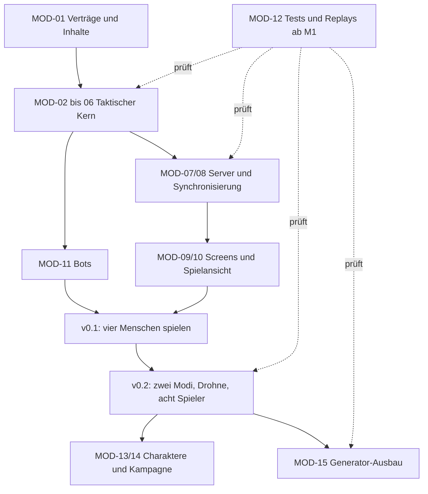

# NEON CONTRACT – Modulplan

Stand: 20.10.2026 · Status: Planungsentwurf, kein implementierter Funktionsumfang.

Dieser Plan zerlegt [Architektur](ARCHITEKTUR.md) und [Prototyp](PROTOTYP.md) in abgrenzbare Systeme. [Screens](SCREENS.md), [Generatoren](GENERATOREN.md) und [Arbeitspakete](ARBEITSPAKETE.md) ergänzen die Sicht auf Benutzeroberfläche, Inhaltserstellung und Umsetzung.

Für jedes der 15 Module beschreibt [MVP_MODULE.md](MVP_MODULE.md) das konkrete Pflichtminimum mit Daten, Fehlerfällen, Nachweis und Nicht-Zielen. Die gemeinsame Arbeitsdefinition steht in [MVP.md](MVP.md).

## 1. Planungsregeln

**Module sind fachliche Grenzen, keine einzelnen Server oder automatisch eigene Pakete.** Mehrere Module können zunächst als Ordner in `packages/sim` oder `apps/client` liegen. Ein eigener Dienst entsteht erst bei einem belegten Bedarf.

Jedes Modul hat Eingaben, Ergebnisse, erlaubte Abhängigkeiten und eine Abnahme. Eine UI darf diese Ergebnisse anzeigen und Befehle auslösen, aber die Regeln nicht noch einmal implementieren.

Die vorhandenen Stufen bleiben erhalten:

- **v0.1 / M1–M3:** vier Runner, handgebaute Kernmission, grundlegende Screens und Reconnect.
- **v0.2 / M4–M5:** Vergleich der Zugmodelle, acht Runner, Drohne, Alarm und Hotjoin.
- **Kampagne / M6:** gespeicherte Charaktere, Fortschritt, Ausrüstung und zweite handgebaute Mission.
- **Ausbau:** Safehouse, Fraktionen, Handel und weitere Missionsarten in einzeln beauftragbaren Schritten nach M6.
- **Generator-Ausbau / M7:** optionaler Arbeitsstrang nach M5 für prozedurale Varianten; Kampagnengeneratoren benötigen zusätzlich Kampagnendaten. M7 ersetzt weder die handgebaute Testmission noch die menschliche Abnahme.

Eine **kleine** Aufgabe verändert eine abgegrenzte Schnittstelle oder Ansicht. Eine **mittlere** verbindet zwei vorhandene Bereiche. Eine **große** muss vor Implementierung in kleinere Aufgaben zerlegt werden. Diese Größen sind keine Terminzusagen.

## 2. Gemeinsame Daten und Zuständigkeiten

- **Spieler/Session:** Verbindung und Berechtigung, verantwortet von MOD-07.
- **Gespeicherter Runner:** kampagnenübergreifende Identität, Fertigkeiten und Ausrüstung, verantwortet von MOD-13.
- **Missionseinheit:** Einsatzinstanz mit HP/AP/Position; erstellt aus einem Preset oder gespeichertem Runner und während des Einsatzes ausschließlich durch die Simulation verändert.
- **MissionDefinition:** vor dem Einsatz geprüfte Karte, Ziele, Gegner und Regeln; verantwortet von MOD-01 und später MOD-15.
- **MissionState:** aktueller vollständiger Regelzustand, verantwortet von MOD-02; nur auf dem Server vollständig verfügbar.
- **TeamView:** aus dem MissionState abgeleitete, erlaubte Information für Clients und passende Bots, verantwortet von MOD-08.
- **MissionResult:** unveränderliches Einsatzergebnis mit eindeutiger ID; später genau einmal auf Kampagnendaten angewendet.
- **Spielereinstellungen:** lokale Anzeige-/Bedienpräferenzen; Raumregeln wie Zugmodus und Timer bleiben serverseitige Raumkonfiguration.

Eine Runner-ID ist keine Session-ID. Ein Reconnect bekommt dieselbe Einsatzinstanz zurück. Ein ausgewähltes Charakterportrait ist kein Besitznachweis.

## 3. Systemmodule

### MOD-01 · Content-Verträge und Versionsverwaltung

**Umfang:** IDs, Datenformate, validierte Regelwerte, Karten-/Waffen-/Gegnervorlagen und Content-Manifest. Kleine Übersetzung von Quelldaten in das normalisierte Missionsformat.

**Ein → Aus:** authored JSON beziehungsweise später Generatorergebnisse → geprüfte, unveränderliche Definitionen mit Content-Hash.

**Abhängigkeiten:** gemeinsame Domain-Typen; keine Netzwerk- oder Rendering-Abhängigkeit.

**Stufe:** M1, für v0.1 nur die konkret benötigten Vorlagen. Skill-/Loot-/Kampagnenformate erst mit ihren Modulen ergänzen.

**Abnahme:** unbekannte IDs, unerlaubte Werte und inkompatible Datenversionen werden verständlich abgewiesen; Fehler enthalten Quelle und Feldpfad.

### MOD-02 · Simulationszustand und deterministische Ausführung

**Umfang:** Zustand, Integer-RNG, Eingabeverarbeitung, Revisionen, stabile Reihenfolgen und Ereignisvertrag.

**Ein → Aus:** Zustand + geordnete Eingabe + Definitionen → Folgezustand + Ergebnis + Ereignisse.

**Abhängigkeiten:** Domain-Definitionen aus MOD-01, reine Regeloperationen aus MOD-03 bis MOD-06; keine Infrastruktur.

**Stufe:** M1, fortlaufend erweitert. Die fachlichen Regeloperationen lesen passende Ausschnitte des Zustands und führen keine unabhängigen Zustandskopien als zweite Wahrheit.

**Abnahme:** gleiche Eingaben liefern gleiche Hashes; ungültige Aktionen ändern weder Ressourcen noch RNG.

### MOD-03 · Raster, Wege, Sicht und Deckung

**Teilbereiche:** Zellbelegung und Nachbarn; Pfadsuche; Sichtstrahlen; Sichtweite/Erkundung; gerichtete Deckung.

**Ein → Aus:** Karte + Einheitenpositionen + Abfrage → Pfad, Sichtmenge, freie Schusslinie oder Deckungsmodifikator.

**Abhängigkeiten:** MOD-01-Datentypen. Keine Abhängigkeit vom Szenen- oder Meshzustand.

**Stufe:** M1 Bewegung, M2 Sicht/Deckung; Rauch und Höhenbonus erst später. Ganzzahlige Zellhöhen sind Kartendaten gemäß [0007](decisions/0007-babylon-taktikansicht.md).

**Abnahme:** feste Gleichstände, keine belegten Zielzellen, getestete Ecken und Deckungsrichtungen. Bekanntes Gelände und aktuell sichtbare Gegner sind getrennt.

### MOD-04 · Aktionen und taktische Ressourcen

**Teilbereiche:** Bewegungsschritte; Zielen/Schießen; Munition/Nachladen; Overwatch; Medkit/Ausfall; später Verletzungen und Cyberware-Effekte.

**Ein → Aus:** Aktionsabsicht + Zustand → Kosten, Legalität und Regelwirkung. Dieselbe Kostenberechnung wird für serverseitige Prüfung und erlaubte Vorschauen verwendet.

**Abhängigkeiten:** MOD-01 und MOD-03. MOD-02 wendet die Wirkung an; MOD-05 bestimmt den Aufrufzeitpunkt.

**Stufe:** M2, Drohnen-/Verletzungsergänzung M4.

**Abnahme:** keine negativen AP, keine doppelte Reaktion, abgebrochene Bewegung nach Ausfall; alle Aktionen haben verständliche Ablehnungsgründe.

### MOD-05 · Zugablauf und Planauflösung

**Teilbereiche:** Teamphasen; Bereitstatus; Fristbarrieren; Gegneraktivierung; simultane Pläne; Konflikt- und Abbruchregeln.

**Ein → Aus:** Befehle/Pläne und protokollierte Frist-Eingaben → geordnete Aktionsausführung und Phasenwechsel.

**Abhängigkeiten:** MOD-02-Vertrag, MOD-04-Aktionen. Die reale Uhr bleibt im Serveradapter.

**Stufe:** Teamzug M2, simultane Planung M4.

**Abnahme:** kein zusätzlicher Einzelzug für einen Spieler/Begleiter; spätere Eingaben können eine geschlossene Phase nicht wieder öffnen.

### MOD-06 · Missionsziele und Weltinteraktionen

**Teilbereiche:** Türen/Terminals; Zielzustände; Extraktion; Sieg/Niederlage; Alarm/Verstärkung; später Eskorte/Sabotage.

**Ein → Aus:** Missionsdefinition + relevante Regelereignisse → Objektzustände, Zieländerungen und eindeutiger Missionsabschluss.

**Abhängigkeiten:** MOD-01 und Regeloperationen MOD-03/MOD-04. Ausführung durch MOD-02.

**Stufe:** M2 Datenraub; M4 Alarm; weitere Missionstypen nach dem Taktiktest.

**Abnahme:** alle Interaktionen sind ohne Pflichtklasse lösbar; Sieg/Verlust können nicht beide gebucht werden. Wiederholte Auswertung dupliziert keine Welle.

### MOD-07 · Session, Lobby und Runner-Besitz

**Teilbereiche:** Raum erstellen/beitreten; Einladungen; Slots; Koordinatorrechte; Startfreigabe; Command-Deduplizierung; Reconnect; Hotjoin.

**Ein → Aus:** authentisierte Session-Nachrichten → zulässige Befehle, Besitzwechsel, Lobbyzustand und Wiederaufnahmeberechtigung.

**Abhängigkeiten:** MOD-01-Protokoll, MOD-02-Eingabevertrag. Colyseus implementiert den Transport in `apps/server`.

**Stufe:** kleiner Verbindungsnachweis M1, vollständiger Viererraum/Reconnect M3, acht Slots/Hotjoin M5.

**Abnahme:** je Runner höchstens ein menschlicher Controller; reservierte Reconnect-Slots sind nicht über Hotjoin übernehmbar. Ein Lobbykoordinator hat keine Sonderrechte an fremden Runnern.

### MOD-08 · Sichtprojektion und Client-Synchronisierung

**Teilbereiche:** serverseitiger Informationsfilter; Schemaabbildung; Snapshots; sequenzierte Ereignisse; Client-Store und Befehlsbestätigung.

**Ein → Aus:** vollständiger Missionszustand → erlaubte TeamView; Netzwerkpakete → konsistente lokale Anzeige.

**Abhängigkeiten:** MOD-02, MOD-03 und MOD-07. Interface-Spezifikation vor der vollständigen Cliententwicklung.

**Stufe:** M3.

**Abnahme:** verborgene Gegner erscheinen weder in Payloads noch in Fehlerdetails; Event-Lücken lassen sich durch einen Snapshot beheben. Animationen ändern keine Spielregeln.

### MOD-09 · Anwendung, Navigation und Einstellungen

**Teilbereiche:** Hauptmenü; Raumzugang; Screenrouting; Fokus/Dialogs; Settings; Hilfe; Anzeige von Verbindungsfehlern.

**Ein → Aus:** lokale Benutzereingaben + Sessionzustand → Navigation, lokale Präferenzen oder fachliche Befehle.

**Abhängigkeiten:** MOD-07/MOD-08 für Onlinezustände. Ein Screenwechsel erzeugt keine neue Serverautorität.

**Stufe:** M3 minimale Benutzerführung; Kampagnennavigation mit M6.

**Abnahme:** Rücknavigation verliert keine aktive Session unbemerkt; Settings pausieren den gemeinsamen Einsatz nicht. Änderungen an der Raumkonfiguration invalidieren betroffene Bereitmeldungen.

### MOD-10 · Taktikkarte und Gefechtsoberfläche

**Teilbereiche:** Babylon.js-Ansicht; orthografische Kamera mit 45-Grad-Neigung, 90-Grad-Drehung und Zoom; Auswahl; Pfad-/AP-Vorschau; Aktionsleiste; Gegner-/Objektdetails; Phasenanzeige; taktische Übersichtskarte. Siehe [0007](decisions/0007-babylon-taktikansicht.md).

**Ein → Aus:** TeamView + bestätigte Ereignisse → Darstellung; Kartenauswahl → Befehlsabsicht.

**Abhängigkeiten:** MOD-08/MOD-09, Assets aus MOD-01. Vorschauen verwenden nur bekannte Information.

**Stufe:** M3; Planpfade/Drohnensteuerung M4.

**Abnahme:** vollständige Mission mit Maus/Tastatur spielbar; Zustände nicht nur farblich erkennbar; übersprungene Animationen führen zum richtigen Endzustand.

### MOD-11 · Bots und Begleitersteuerung

**Teilbereiche:** Gegner-Policies; Crew-Testbots; defensive Übernahme; Befehlsadapter für Drohnen; später weitere Begleiter.

**Ein → Aus:** erlaubte Beobachtung + Policy-Konfiguration + eigener RNG → reguläre Aktionsabsicht.

**Abhängigkeiten:** MOD-01 sowie MOD-04-Befehlstypen und gefilterte Beobachtungsverträge. Die Simulationsbibliothek importiert keine Bot-Policy.

**Stufe:** M2 grundlegende Bots, M3 Ausfallübernahme, M4 Policy-Vergleich/Drohne.

**Abnahme:** Bots kennen keine verborgenen Gegenwartpositionen; Rechenbudget begrenzt in Schritten; eine Drohne erhält keinen zusätzlichen Vollzug.

### MOD-12 · Tests, Replays und Auswertung

**Teilbereiche:** Regel-/Invariantenprüfungen; Replay-Runner; Serverintegration; Mehrbrowser-Tests; Batch-Simulation und menschliche Testprotokolle.

**Ein → Aus:** Versionen, Content, Eingaben/Seeds → reproduzierbare Fehler oder nachvollziehbare Test-/Balanceberichte.

**Abhängigkeiten:** jeweils die geprüften Module; Produktcode hängt nicht von Testwerkzeugen ab.

**Stufe:** beginnt M1, wächst mit jedem Slice.

**Abnahme:** jeder Fehler ist einem Seed/Eingabestrom/Build zuordenbar; tatsächliche Spielzeit wird getrennt von Headless-Runden gemessen.

### MOD-13 · Charaktere, Skills und Ausrüstung

**Teilbereiche:** Runner-Identität; Attribute; freie Spezialisierung; Skilldefinitionen/Voraussetzungen; XP/Level; Inventar/Loadout; später Cyberware und Begleiterfreischaltung.

**Entwurfsrichtung:** [Gestufte Charakterentwicklung](CHARAKTERENTWICKLUNG.md): zunächst Physisch, Sozial und Mental; Attribut- und Fertigkeitszweige öffnen günstigere Spezialisierungen an Wertschwellen. Der Vorschlag unterscheidet dauerhafte Kompetenz, gelernte Techniken und aktuelle Ausrüstungsquellen einer Aktion. Konkrete Kosten und Schwellen sind noch offen.

**Ein → Aus:** gespeicherter Runner + validierter Änderungsbefehl → neue Charakterrevision; vor Missionsbeginn → eingefrorener Einsatz-Loadout.

**Abhängigkeiten:** MOD-01 einschließlich eines kleinen abstrakten Speichervertrags. MOD-14 implementiert dessen IO-Seite. Skills referenzieren bereits implementierte Effekte aus MOD-04, keinen beliebigen Skripttext.

**Stufe:** M6. In v0.1 lediglich feste Presets, noch kein vollständiges Progressionssystem.

**Abnahme:** Skills haben eindeutige Kosten, Voraussetzungen und Auswirkungen; kein doppeltes Ausgeben von Punkten bei zwei geöffneten Tabs. Entwicklung schafft Optionen und keine Pflichtrollen.

### MOD-14 · Kampagne, Persistenz und gemeinsame Ressourcen

**Teilbereiche:** Save-Versionen; Runner-/Crew-Zuordnung; idempotente Resultatbuchung; zweiter Auftrag; später Safehouse, Fraktionsruf, Lager/Handel und Kampagnenkarte.

**Ein → Aus:** MissionResult oder erlaubte Kampagnenaktion → transaktional aktualisierter Kampagnenzustand.

**Abhängigkeiten:** MOD-01-Verträge und fachliche Definitionen von MOD-13. Die konkrete Speicheranbindung implementiert den abstrakten Vertrag; MOD-13 importiert diese Anbindung nicht. So entsteht keine gegenseitige Importabhängigkeit.

**Stufe:** M6 minimaler Speicher und Resultate; Safehouse/Handel/Fraktionen als getrennte Ausbauaufgaben.

**Abnahme:** wiederholte Missionsresultate geben keine doppelten XP/Gegenstände; Abwesende verhindern keine neue Mission; Save-Laden und Migration geprüft.

### MOD-15 · Inhaltserstellung und Generator-Pipeline

**Flurerschließung Version 5:** Ein eigenes verbundenes Flurnetz mit Wand-/Türtrennung ersetzt Durchgangswege durch Büros. Kurze WC-Wege werden auf der realen Zellgeometrie geprüft und in der Werkstatt angezeigt; CEO höchstens 16 Raster-Schritte. Flächenstufen 28×24 / 32×28 / 32×32, Format 5. Zugangshallen bleiben Programmräume; Flurfelder werden separat bilanziert. Festlegung und Grenzen: [0014](decisions/0014-flurerschliessung-und-sanitaerwege.md). Die folgenden Versionsbeschreibungen sind frühere Ausbaustände.

**Konzernmodell Version 4:** Vier fiktive Identitäten, Standortrolle, Abteilung und Ausbauzustand erweitern das Raumprogramm um Arbeitsrollen und verpflichtende Beziehungen. Materialien und Abnutzung werden getrennt von Missionsregeln erzeugt; siehe [0012](decisions/0012-konzernidentitaet-und-bueroorganisation.md).

**Vorhandener Teilschnitt:** lokaler Gebäudegenerator und separate Werkstatt nach [0009](decisions/0009-semantischer-gebaeudegenerator.md). Drei Familien, harte Prüfungen und eingefrorener Export; Laden im normalen Missionsclient und M7-Abschluss sind offen.

Version 3 ergänzt vor der Geometrie ein Betriebs-/Kapazitätsmodell mit örtlichem und äußerem Bedarf, variablen Raumzahlen und Mindestflächen. Es bleibt außerhalb von `sim`; Beschäftigte erzeugen keine zusätzlichen Einheiten. Festlegung: [0011](decisions/0011-bedarfsbasiertes-raumprogramm.md).

**Teilbereiche:** Missions-/Level-/NPC-/Encounter-/Ausrüstungsgeneratoren; Validierung; Vorschau; Paketierung; optional Text-/Assetproduktion.

**Ein → Aus:** Seed + Versionen + erlaubte Vorlagen + Randbedingungen → geprüfte MissionDefinition beziehungsweise persistierter Inhaltsvorschlag.

**Abhängigkeiten:** MOD-01-Formate; Geometrieabfragen aus MOD-03 für Prüfungen; MOD-12 für Simulationstests. Kein Generator im Client-Renderzyklus.

**Stufe:** v0.1 Vorlagen laden und validieren; v0.2 Varianten auswählen; eigentliche prozedurale Erzeugung M7 in den Generatorstufen aus [0008](decisions/0008-hierarchischer-missionsgenerator.md).

**Abnahme:** wiederholbare Ergebnisse, begrenzte Versuche, brauchbarer Fehlerbericht und expliziter Rückfall auf eine geprüfte Vorlage. Detailmodule: [GENERATOREN.md](GENERATOREN.md).

## 4. Aufbaufolge

Das Diagramm zeigt Lieferabhängigkeiten, keine vorgeschriebene Aufteilung auf mehrere Coding-Agenten.

## 5. Übergaberegel für ein Modul

Vor Implementierung: ID, Umfang, bestehende Datenverträge, betroffene Dateien, Nicht-Ziele und Abnahme des konkreten Arbeitspakets festhalten.

Bei Übergabe: Beispielinput/-output, behandelte Fehlerfälle, tatsächlich ausgeführte Tests und verbleibende Einschränkungen nennen. Ein Modul mit Mockdaten kann eine UI-Entwicklung unterstützen, gilt dadurch aber noch nicht als an den echten Server angebunden.

Kein Modul wird „fertig“ genannt, nur weil seine Oberfläche sichtbar ist: Ein Levelaufstieg braucht eine korrekt gebuchte Änderung, Reconnect einen wiederhergestellten Besitz, ein Generator eine geprüfte und reproduzierbare Ausgabe.
