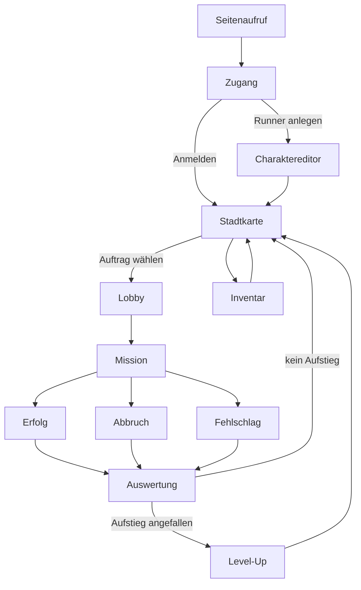

# NEON CONTRACT – Sitemap, User Flows und Navigation

Stand: 23.10.2026

Dies ist ein Navigationskonzept. Es ist keine Produktfreigabe. [MVP_SCREENS.md](MVP_SCREENS.md) bleibt die Screen-Spezifikation, [SCREENS.md](SCREENS.md) die ältere Ablaufplanung. Dieses Dokument ersetzt keines von beiden und ändert keine Buchung und keine Missionsroute.

`http://127.0.0.1:5173/` zeigt diese Sitemap als Prüfliste für das manuelle Testen. Vorhandene Flächen sind dort Sprünge, geplante Flächen bleiben ohne Sprung. Siehe [0039](decisions/0039-testeinstieg-aus-der-sitemap.md).

Die Markierung folgt dem Client an diesem Tag. `vorhanden` heißt: die Fläche ist im Client erreichbar. `geplant` heißt: die Fläche oder der Ausgang fehlt. `Lücke` heißt: ein Sprung des Konzepts ist noch nicht gebaut. Eine vorhandene Fläche mit einer Lücke im Zuweg bleibt vorhanden.

Geprüft sind die Weiche `stueck` in `apps/client/src/App.tsx`, der Zugang, die Charaktererstellung, die Lobby, die Papierpuppe, die Taktikansicht, das Ergebnis, die Stadtkarte unter `?stueck=stadt` und die lokalen Einstellungen.

## 1. Sitemap

Der Baum beginnt beim Seitenaufruf und zeigt den gewünschten Weg. Der Etagenwechsel ist eine Ansicht in der Mission.

```text
Seitenaufruf
└── Zugang                                          vorhanden
    Anlegen, Anmelden und Wiederaufnehmen liegen hier.
    ├── Charaktereditor                             vorhanden
    │   nur beim Anlegen eines neuen Runners
    └── Stadtkarte                                  vorhanden
        Heimat im Konzept. Zuweg vom Zugang: Lücke
        ├── Missionsauswahl                         geplant
        ├── Lobby                                   vorhanden
        │   Erstellen und Beitreten. Zuweg von der Karte: Lücke
        │   Slot, Einsatzwahl, Bereit und Frist liegen in der Lobby
        ├── Inventar                                vorhanden in der Lobby
        │   Zuweg von der Stadtkarte: Lücke
        ├── Level-Up                                geplant
        └── Mission                                 vorhanden
            Etagenwechsel und taktische Übersicht: Ansichten
            ├── Erfolg                              geplant als eigener Ausgang
            ├── Abbruch                             geplant als eigener Ausgang
            └── Fehlschlag                          geplant als eigener Ausgang
                └── Auswertung                      geplant
                    ├── Level-Up                    geplant, nur bei Aufstieg
                    └── Stadtkarte                  Rückweg: Lücke

Einstellungen                                       vorhanden auf dem Missionsstück
    über Zugang, Lobby, Mission und Ergebnis
    auf Stadtkarte und im Charaktereditor: Lücke
Hilfe                                               vorhanden, gleiche Reichweite
    wie die Einstellungen auf dem Missionsstück
```

### Zugang

Vorhanden auf `?stueck=mission`, solange kein Raumstand da ist. Eine Fläche für Runner-Name, Passwort und Einladungscode. „Runner anlegen“ öffnet den Charaktereditor. „Anmelden“ führt am Charaktereditor vorbei. „Wieder aufnehmen“ erscheint bei einer gespeicherten Aufnahme und verbindet wieder mit Lobby oder Mission. Einstellungen und Hilfe liegen auf derselben Fläche. Der Account ist dieser Zugang.

### Charaktereditor

Vorhanden, ausschließlich nach „Runner anlegen“. Aussehen, die Attribute Physisch, Sozial und Mental, dazu die drei Platzhalter Fertigkeit 1, Fertigkeit 2 und Fertigkeit 3. Zurück verwirft den Entwurf. Der Eintrag entsteht mit Bestätigen. Danach soll die Stadtkarte folgen. Heute schließt der Client denselben Schritt mit Raum oder Beitritt ab.

### Stadtkarte

Vorhanden auf `?stueck=stadt`, getrennt vom Missionsstück. Sie zeigt die Rhein-Ruhr-Übersicht: leuchtende Orte, weiße Korridore, Drehen der Ansicht. Die Fläche erzeugt keine Deckung, keine Sichtlinie und keine Mission. Aufträge lassen sich dort nicht wählen. Von Zugang, Lobby und Ergebnis führt kein Sprung hierher, und von der Karte führt keiner zurück.

### Lobby

Vorhanden, sobald der Raum in der Lobby-Phase ist. Vier Slots, Einladungscode, festes Briefing „Ghost Floor“, Bereit, Crewfrist 60, 90 oder 120 Sekunden und Start durch den Koordinator. Ein freier Slot wird beim Betreten belegt. Dafür gibt es keinen eigenen Screen. „Abmelden“ löst die eigene Sitzung in der Vorbereitung und zeigt wieder den Zugang. Der Missionsabbruch ist der spätere Ausgang aus dem Einsatz.

### Inventar

Vorhanden als Fläche in der Lobby. Die Überschrift lautet Inventar, die Darstellung ist die Papierpuppe mit Lager. Verschieben geht durch, solange das Lager offen ist. In der Mission zeigt die Taktikansicht diese Fläche nicht. Das Öffnen von der Stadtkarte ist geplant.

### Mission

Vorhanden als Taktikansicht, sobald der Raum in der Missionsphase ist. Aktionen, Crew, Charakterbogen, Drehen, Zoom und die Übersicht bleiben in dieser Ansicht. Der Etagenwechsel schaltet mit „Etage hoch“ und „Etage runter“ die gezeigte Etage um. Er ist eine Ansicht in der Mission. Die Übersicht ist dieselbe Art Ansicht. Ein Knopf hinaus zur Stadtkarte fehlt, ebenso ein Abbruch.

### Erfolg, Abbruch, Fehlschlag und Auswertung

Geplant als drei Ausgänge mit einer gemeinsamen Auswertung danach.

Vorhanden ist ein Ergebnis-Screen. Er trägt bei `sieg` die Überschrift Erfolg und bei `niederlage` die Überschrift Niederlage, zeigt Runde, Grund, Buchungszeile und den Knopf „Zum Zugang“. Die Ausgänge im Regelkern sind `sieg` und `niederlage`. Ein eigener Abbruch-Ausgang und eine Auswertung, die danach zur Stadtkarte führt, sind geplant. Der Ergebnis-Screen ist die vorhandene Vorlage der Auswertung.

### Level-Up

Geplant. Im Client gibt es keine Aufstiegsfläche.

### Einstellungen und Hilfe

Vorhanden auf Zugang, Lobby, Mission und Ergebnis. Die Einstellungen bieten Schriftgröße 100, 115 und 125 Prozent, Kontrastmarken, weniger Bewegung und „Standard wiederherstellen“. Die Wahl bleibt auf diesem Gerät und ändert weder Aktionspunkte noch die Crewfrist. Zurück schließt auf die Fläche, von der aus geöffnet wurde. Die Hilfe folgt demselben Muster. Stadtkarte und Charaktereditor haben diesen Einstieg noch nicht.

### Technikstücke, keine Spielerorte

Diese Routen sind im Client erreichbar und gehören nicht in den Spielerbaum:

- Aufruf ohne `stueck`: Prüfliste dieser Sitemap. `sicht`: Sicht-Stück
- `aktionspunkte`, `schuss`, `deckung`, `raster`: ältere Technikstücke
- die Charakterwerkstatt und der Generator: eigene Seiten, nicht der Charaktereditor im Zugang

## 2. User Flows

Die Wege sind das Konzept. Wo der Client anders läuft, steht die Lücke am Ende des Weges.

### Erster Seitenaufruf und Wiederkehr

1. Der Spieler öffnet `?stueck=mission` und sieht den Zugang.
2. Beim ersten Mal sind Name und Passwort leer. „Wieder aufnehmen“ fehlt.
3. Eine spätere Rückkehr mit gespeicherter Aufnahme verbindet über „Wieder aufnehmen“ wieder mit der laufenden Lobby oder Mission.
4. Eine Rückkehr ohne Aufnahme meldet den Runner an und führt auf die Stadtkarte.
5. Lücke: die Anmeldung öffnet heute den Raum oder tritt einem Code bei. Ein Aufruf ohne `stueck` zeigt die Prüfliste. Der Spielzugang ist `?stueck=mission`, die Testmission ist `?stueck=sicht`.

### Runner anlegen, danach Stadtkarte

1. Im Zugang Name und Passwort eintragen.
2. „Runner anlegen“ öffnet den Charaktereditor.
3. Aussehen wählen, Physisch, Sozial und Mental verteilen, die drei Fertigkeits-Platzhalter setzen.
4. Bestätigen legt den Runner an.
5. Die nächste Fläche ist die Stadtkarte.
6. Lücke: Bestätigen öffnet heute die Lobby, bei leerem Code als neuer Raum und bei gesetztem Code als Beitritt.

### Anmelden ohne Editor

1. Im Zugang Name und Passwort eintragen.
2. „Anmelden“ prüft den vorhandenen Runner.
3. Der Charaktereditor bleibt zu.
4. Die nächste Fläche ist die Stadtkarte.
5. Lücke: auch die Anmeldung öffnet heute direkt die Lobby.

### Lobby erstellen und Lobby beitreten

Erstellen:

1. Auf der Stadtkarte eine private Runde öffnen.
2. Die Lobby zeigt den Einladungscode, die vier Slots, das Inventar, Bereit und die Crewfrist.
3. Der Koordinator setzt bei Bedarf Bots und startet, sobald die belegten Plätze bereit sind und eine Waffe gewählt ist.

Beitreten:

1. Den Einladungscode eintragen.
2. Dieselbe Lobby öffnet sich auf dem eigenen Slot.

Lücke: Erstellen und Beitreten entscheiden sich heute auf dem Zugang. Ein leerer Code erzeugt den Raum, ein gesetzter Code tritt bei. Die Stadtkarte hat keinen Zugang zur Lobby.

### Missionsauswahl auf der Stadtkarte

1. Auf der Stadtkarte einen Auftrag wählen.
2. Die Lobby öffnet sich mit diesem Auftrag, seinem Briefing und der Bereitschaft der Crew.
3. Lücke: die Stadtkarte nimmt keine Auswahl an. Die Lobby zeigt fest den Auftrag Ghost Floor.

### Mission spielen

1. „Mission starten“ wechselt von der Lobby in die Taktikansicht.
2. Der Spieler handelt in dieser Ansicht. Etage, Drehung und Übersicht wechseln nur die Darstellung.
3. Einstellungen und Hilfe legen sich darüber und schließen wieder auf die Mission. Der Einsatz läuft weiter.
4. Dieser Wechsel Lobby zu Mission ist vorhanden.

### Erfolg, Abbruch und Fehlschlag

1. Erfolg beendet den gewonnenen Einsatz und öffnet die Auswertung.
2. Abbruch ist der eigene, gemeinsame Ausgang aus dem Einsatz und öffnet dieselbe Auswertung.
3. Fehlschlag beendet den verlorenen Einsatz und öffnet dieselbe Auswertung.
4. Lücke: der Client sammelt `sieg` und `niederlage` in einem Ergebnis-Screen. Ein Abbruch-Ausgang ist nicht gebaut. „Abmelden“ gibt es in der Lobby und löst dort nur die eigene Sitzung.

### Auswertung, dann Level-Up oder Stadtkarte

1. Die Auswertung zeigt das Ergebnis, das genau einmal gebucht wurde.
2. Liegt ein Aufstieg an, öffnet sich Level-Up. Danach folgt die Stadtkarte.
3. Liegt kein Aufstieg an, folgt die Stadtkarte direkt.
4. Lücke: der Ergebnis-Screen schließt mit „Zum Zugang“. Level-Up fehlt. Die Buchung selbst bleibt die vorhandene, einmalige Buchung aus Abschnitt 3.

### Inventar von der Stadtkarte

1. Auf der Stadtkarte das Inventar öffnen.
2. Schließen kehrt auf die Stadtkarte zurück.
3. Während einer laufenden Runde bleibt das Inventar geschlossen, auch im Zug einer anderen Person.
4. Lücke: das Inventar steht heute in der Lobby. Die Taktikansicht blendet es aus, sobald der Einsatz läuft.

### Einstellungen von überall

1. Auf der aktuellen Fläche Einstellungen öffnen.
2. Schriftgröße, Kontrast und Bewegung gelten nur auf diesem Gerät.
3. Schließen kehrt auf dieselbe Fläche zurück. Eine offene Mission endet dadurch nicht.
4. Vorhanden auf Zugang, Lobby, Mission und Ergebnis. Lücke auf der Stadtkarte und im Charaktereditor.

## 3. Navigationskonzept

Wenige Orte tragen die Reise. Die Stadtkarte ist die Heimat. Aus der Mission führt der Weg über Erfolg, Abbruch oder Fehlschlag in die Auswertung und von dort zurück zur Stadtkarte.

### Feste Orte

- **Zugang.** Anlegen, Anmelden, Wiederaufnehmen.
- **Stadtkarte.** Heimat nach dem Zugang und nach der Auswertung. Von hier gehen Auftrag, Lobby, Inventar und ein offener Level-Up aus.
- **Lobby.** Crew, Slot, Einsatzwahl, Bereit, Frist, Start und Beitritt.
- **Mission.** Der laufende Einsatz. Die Navigation bleibt auf dieser Fläche. Etagenwechsel und Übersicht sind Ansichten darin.
- **Auswertung.** Die gemeinsame Station nach Erfolg, Abbruch und Fehlschlag.

Charaktereditor, Inventar, Level-Up und Einstellungen sind Flächen. Der Editor geht vom Zugang aus und nur bei der Erstanlage. Inventar und ein nachgeholter Level-Up gehen von der Stadtkarte aus. Level-Up erscheint nach der Auswertung nur dann, wenn ein Aufstieg angefallen ist. Einstellungen und Hilfe liegen über der aktuellen Fläche und schließen wieder dorthin. In der Mission legen sie sich über den Einsatz, ohne ihn zu beenden.

Der Abbruch ist ein eigener Ausgang. Der Fehlschlag ist der verlorene Einsatz. Beide treffen sich mit dem Erfolg in der Auswertung.

### Einmal buchen

Die Auswertung nimmt jeden der drei Ausgänge entgegen und bucht das Ergebnis einmal. Das bleibt Konzept und verweist auf die vorhandene Buchung.

`applyMissionResult` in `packages/sim/src/campaign.ts` weist eine Ergebnis-ID ab, die schon verbucht ist. `bookHeld` in `apps/server/src/runnerAccount.ts` schreibt dieselbe ID nur, solange sie noch nicht im Buchungsregister des Runners steht. Ein Abbruch, der das eingefrorene Set freigibt, läuft über `releaseFreeze` und `releaseHold` und legt dabei keine zweite Buchung an. Die Navigation führt auch diesen Ausgang in die Auswertung. Die Buchungsregel bleibt unverändert. Der vorhandene Ergebnis-Screen zeigt die Buchung an und stößt keine weitere an.

### Lücken

Diese Sprünge sind Konzept und im Client noch nicht gebaut:

- vom Zugang und vom Charaktereditor auf die Stadtkarte
- von der Stadtkarte in eine neue Lobby und in eine Lobby per Code
- die Missionsauswahl auf der Stadtkarte
- drei getrennte Ausgänge Erfolg, Abbruch und Fehlschlag
- von diesen Ausgängen in eine Auswertung und weiter zum Level-Up oder zur Stadtkarte
- das Inventar als Einstieg von der Stadtkarte
- Einstellungen und Hilfe auf der Stadtkarte und im Charaktereditor

Vorhanden und damit keine Lücke sind: Zugang zu Editor, Anmeldung und Anlegen in die Lobby, Lobby in die Mission, Mission in den gemeinsamen Ergebnis-Screen, Ergebnis zum Zugang, Wiederaufnehmen in Lobby oder Mission, Einstellungen und Hilfe auf dem Missionsstück, die Stadtkarte als eigene Adresse.



Das Diagramm zeigt das Konzept. Gebaut sind davon der Zugang, der Charaktereditor, die Lobby, die Mission, der gemeinsame Ergebnis-Screen für Erfolg und Niederlage und die Einstellungen auf dem Missionsstück. Die Pfeile über die Stadtkarte, die drei Ausgänge, die Auswertung, Level-Up und das Inventar sind Lücken.
