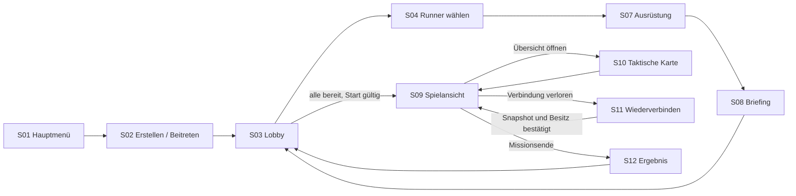
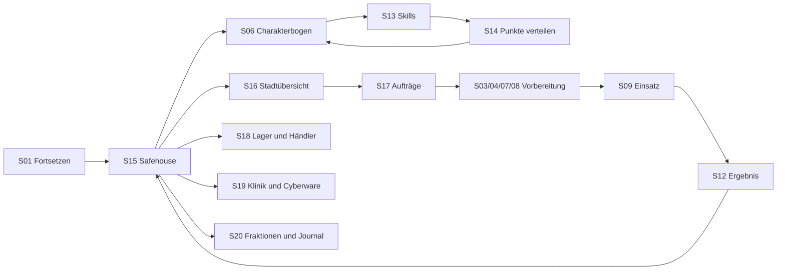

# NEON CONTRACT – Screens und Spielerabläufe

Stand: 20.10.2026 · Status: funktionale Screenplanung, noch kein UI-Design oder lauffähiger Prototyp.

Bezug: [Module](MODULE.md), [Prototypumfang](PROTOTYP.md), [Arbeitspakete](ARBEITSPAKETE.md).

Die konkrete Minimalversion jeder Ansicht einschließlich ihrer Zustände und eines Abnahmenachweises steht in [MVP_SCREENS.md](MVP_SCREENS.md). Welche davon zum ersten Vier-Spieler-Stand gehören, legt [MVP.md](MVP.md) fest.

## 1. Grundstruktur

Die Anwendung hat drei Bereiche: **Zugang und Crewvorbereitung**, **laufender Einsatz** und **spätere Kampagne**. Settings und Hilfe sind von mehreren Bereichen erreichbar.

Ein Screen ist hier eine fachliche Ansicht. Nicht jede Ansicht benötigt eine eigene Vollbildseite: Charakterdetails, taktische Übersicht und Skilldetails können Panels sein. Reconnect und Fehlermeldungen sind Zustände derselben Session.

Zwei Karten sind ausdrücklich getrennt:

- **Taktische Übersichtskarte S10:** die aktuelle Einsatzkarte mit derselben erlaubten Sicht wie die Spielansicht; ab v0.1.
- **Strategische Übersichtskarte S16:** Stadtbezirke, Fraktionen und verfügbare Aufträge; späterer Kampagnenausbau, keine Open World.

Für v0.1 wird nur die zusammenhängende Strecke bis zum Missionsende gebaut. Spätere Funktionen stehen im Plan, werden im Prototyp aber nicht durch funktionslose Menüeinträge angekündigt.

## 2. Spielerwege

### Erster spielbarer Stand

S04, S07 und S08 sind Tabs beziehungsweise Panels innerhalb der Lobby. Nur der eigentliche Start wechselt die ganze Gruppe in den Einsatz. „Bereit“ bezieht sich auf die bestätigte aktuelle Konfiguration.

### Kampagnenablauf

Charakterentwicklung bleibt außerhalb der Mission. Ein Spieler darf später freie Punkte behalten und mitspielen, ohne dass die gesamte Crew auf seinen Skillkauf warten muss.

## 3. Zugang, Charakter und Vorbereitung

### S01 · Hauptmenü

**Form/Stufe:** eigener Screen, v0.1. **Module:** MOD-09, MOD-07.

**Inhalt/Aktionen:** „Spiel erstellen“, „Beitreten“, „Einstellungen“, „Hilfe“. „Einsatz fortsetzen“ nur bei tatsächlich wiederaufnehmbarer Session; Kampagne laden erst mit M6.

**Zustände:** normal; Server nicht erreichbar; vorhandene Wiederaufnahme; inkompatible Spielversion. Eine ungültige Wiederaufnahme zeigt ihren Grund und führt zum normalen Zugang.

**Abnahme:** Von hier erreicht man ohne Entwicklerwerkzeuge eine neue oder bestehende Session; ein alter gespeicherter Token wird nicht als funktionierender Spielstand ausgegeben.

### S02 · Raum erstellen / Beitreten

**Form/Stufe:** Zugangsdialog oder eigener Screen, v0.1. **Module:** MOD-07/MOD-09.

**Inhalt/Aktionen:** Anzeigename, Raum erstellen, Einladungscode/-link eingeben. Im lokalen Test optional Serveradresse unter „Erweiterte Verbindung“; normale Spieler müssen keine Ports konfigurieren.

**Daten/Fehler:** Server bestätigt Raum und Session. Fehler für ungültigen Code, vollen Raum, laufende Mission ohne freien Hotjoin-Slot und Versionskonflikt. Wiederholter Klick erstellt nicht mehrere Räume.

**Abnahme:** Einladungen führen in die richtige Lobby; Zurück bricht nur den eigenen noch nicht abgeschlossenen Beitritt ab.

### S03 · Lobby und Crew

**Form/Stufe:** gemeinsamer Vorbereitungsscreen, vier Slots v0.1, acht v0.2. **Module:** MOD-07/MOD-09.

**Inhalt/Aktionen:** menschliche/botgesteuerte Slots, Runner/Preset, Verbindungsstatus, Bereitmeldung, Mission, Zugmodus, Zeitbudget, Einladung und Start. Der Raumkoordinator verwaltet zulässige Raumoptionen; jeder Spieler seinen Runner.

**Zustände:** Slot reserviert; Auswahl in Bearbeitung; nicht bereit; bereit; Start läuft; Teilnehmer fällt aus. Änderungen an Mission/Modus/Timer setzen alle Bereitmeldungen zurück; Loadoutwechsel die des betroffenen Spielers.

**Abnahme:** Start prüft serverseitig die konkrete Konfigurationsrevision und alle benötigten Slots. Gleichzeitiger Start und Loadoutwechsel kann keinen halbfertigen Einsatz erzeugen.

### S04 · Charakterauswahl

**Form/Stufe:** Lobby-Panel, v0.1 Presets, M6 gespeicherte Runner. **Module:** MOD-07; später MOD-13/MOD-14.

**Inhalt/Aktionen:** verfügbare Runner/Presetkarten mit Name, Kurzprofil und Ausrüstung; auswählen, Details öffnen, später neuen Runner erstellen.

**Besitz:** Mehrere Menschen dürfen dasselbe Ausrüstungs-Preset wählen. Eine konkrete gespeicherte Runner-Identität kann in einer Mission nur einmal und nur mit passender Berechtigung eingesetzt werden.

**Abnahme:** Auswahl wird erst nach Serverbestätigung als belegt angezeigt. Bei Konkurrenz bleibt die andere Auswahl verfügbar statt einen fremden Runner zu überschreiben.

### S05 · Charaktererstellung

**Form/Stufe:** kurzer Ablauf, M6; keine Pflicht für v0.1. **Module:** MOD-13/MOD-14.

**Inhalt/Aktionen:** Name, Portrait aus vorhandenem Katalog, Hintergrund und Startausrüstung; später begrenzte Startpunkte. Spezialisierung über Eigenschaften und Ausrüstung, keine unumkehrbare Klassenauswahl.

**Entwurfsrichtung für freie Startpunkte:** zunächst Physisch, Sozial und Mental; spätere Spezialisierungen abhängig von Wertschwellen. Beispiele und offene Kostenregeln stehen in [CHARAKTERENTWICKLUNG.md](CHARAKTERENTWICKLUNG.md).

**Zustände:** Entwurf, ungültiger Name/Punktebudget, Speichern, gespeichert. Ein Hintergrund gibt nur vorher festgelegte Effekte; generierter Flavourtext verändert keine Werte.

**Abnahme:** Erstellen ist idempotent; Zurück verwirft nach Hinweis den Entwurf. Ein erstellter Runner erscheint in S04 mit identischer ID.

### S06 · Charakterbogen

**Form/Stufe:** Informationspanel in v0.1, vollständiger Screen/Tab mit M6. **Module:** MOD-08; später MOD-13.

**Inhalt/Aktionen:** im Einsatz aktuelle HP/AP, Waffe, Munition, Zustände und Besitz. In der Kampagne zusätzlich Attribute, XP, Skills, Cyberware und Begleiter; Verweise auf S07/S13/S19.

**Entwurfsrichtung M6:** gewählte beziehungsweise freigeschaltete Zweige auffächern; Grundwert, eigener Zuschlag, effektiver Bereichswert und Ausrüstungsmodifikatoren unterscheiden. Gelernte Techniken bleiben sichtbar, wenn ihre benötigte Ausrüstung fehlt.

**Zustände:** fremder Runner nur lesbar; eigene Kampagnenfigur bearbeitbar; Einsatz-Loadout gesperrt. Geheime Gegnerwerte werden nicht durch einen allgemeinen Charakterdialog offengelegt.

**Abnahme:** Der Screen verwechselt dauerhaft gespeicherte Werte nicht mit momentanen Einsatzwerten.

### S07 · Ausrüstung und Einsatz-Loadout

**Form/Stufe:** Lobby-Panel v0.1, Inventaransicht M6. **Module:** MOD-01/MOD-07; später MOD-13/MOD-14.

**Inhalt/Aktionen:** zunächst zwei Waffen-Presets und deren festes Medkit. Später Waffenslots, Magazine, Gadgets, Cyberware-/Begleiterbezug, Vergleich und Belastungsgrenzen.

**Entwurfsrichtung M6:** der Gegenstandsvergleich nennt auch hinzugefügte oder entfallende Aktionen. Geräteeigene Funktionen, gelernte Techniken und benötigte Ausrüstung werden gemäß [Charakterentwicklung](CHARAKTERENTWICKLUNG.md) erklärt.

**Daten/Fehler:** serverseitig bestätigter Loadout. Gegenstand nicht verfügbar, Slot unpassend, Budget überschritten oder Missionsstart bereits erfolgt sind sichtbare Fehler.

**Abnahme:** Start friert den Loadout ein. Umbauen in einem zweiten Tab erzeugt keine doppelten Gegenstände oder zusätzlichen Einsatzressourcen.

### S08 · Briefing

**Form/Stufe:** Lobby-Panel, v0.1. **Module:** MOD-06/MOD-09.

**Inhalt/Aktionen:** Hauptziel, Extraktion, bekannte Risiken, kurze Bedienhinweise und erlaubte Vorabinformation zur Karte. v0.1 zeigt „Ghost Floor“, später den ausgewählten Auftrag.

**Daten:** freigegebene Auftragsinformation, keine vollständigen Gegnerpositionen oder geheimen Generatorparameter.

**Abnahme:** Spieler verstehen Sieg, Verlust und Extraktion vor dem Bereitmelden. Lesen des Briefings erzeugt noch keine Mission oder Belohnung.

## 4. Einsatz und Unterbrechungen

### S09 · Spielansicht

**Form/Stufe:** zentraler Screen, v0.1. **Module:** MOD-04/05/06/08/10.

**Inhalt:** Karte als Hauptfläche, auswählbarer eigener Runner, Crewstatus, Phase/Timer, Hauptziel, Aktionsleiste und kurzes Ereignisprotokoll. Die Karte ist die orthografische Babylon.js-Ansicht aus [0007](decisions/0007-babylon-taktikansicht.md): 45 Grad geneigt, drehbar in 90-Grad-Schritten, mit Zoom. Details bei Auswahl statt dauerhaft voller Textspalten.

**Aktionen:** Bewegung, Zielen, Schießen, Nachladen, Overwatch, Medkit, Interaktion, Extraktion, Bereit, Kamera drehen, Zoom und Übersicht. v0.2 ergänzt Planbearbeitung, Konflikthinweise und Drohnenauswahl.

**Zustände:** Eingabe möglich; Befehl ausstehend; Plan gesperrt; Gegnerphase; eigener Runner ausgefallen/extrahiert; Verbindung unsicher; Mission beendet.

**Abnahme:** Jede Aktion zeigt Kosten und Bestätigung/Ablehnung. Ein ausgefallener Spieler kann die erlaubte Teamsicht weiter beobachten, aber keine fremde Figur übernehmen.

### S10 · Taktische Übersichtskarte

**Form/Stufe:** vergrößerbares Panel/Overlay, v0.1. **Module:** MOD-03/MOD-08/MOD-10.

**Inhalt/Aktionen:** bekannte Geometrie, Crew, aktuell sichtbare Gegner, bekannte Ziele und Extraktion; Kamera auf gewählten Bereich setzen. Gemeinsame Pings erst als kleine zusätzliche v0.2-Aufgabe.

**Regel:** exakt dieselbe Sichtprojektion wie S09. Keine zweite Datenquelle, die ungesehene Räume, Gegner oder geheime Nebenziele verrät.

**Abnahme:** Öffnen pausiert die Phase nicht; Schließen stellt Kamera/Fokus sinnvoll wieder her.

### S11 · Reconnect und Hotjoin

**Form/Stufe:** Zustandsansicht/Overlay, Reconnect v0.1, Hotjoin v0.2. **Module:** MOD-07/MOD-08/MOD-09.

**Inhalt/Aktionen:** Verbindung verloren, Wiederaufnahme läuft, Bot steuert vorübergehend, Übergabe zur nächsten Crewphase, Platz reserviert oder nicht mehr verfügbar. Verbindungsversuch wiederholen beziehungsweise zurück zum Zugang.

**Daten:** serverseitiger Besitzstatus, Frist und bestätigter Snapshot. Ein neuer Spieler sieht nur übernehmbare Slots; reservierte Runner sind gesperrt.

**Abnahme:** Eingaben erst nach gültigem Besitz und Synchronisierung; ein Disconnect während Animation oder Planung dupliziert keine Aktion.

### S12 · Ergebnis und Nachbereitung

**Form/Stufe:** eigener Screen, v0.1, Belohnungen ab M6. **Module:** MOD-06/MOD-12; später MOD-13/MOD-14.

**Inhalt/Aktionen:** Erfolg/Verlust, Ziele, Extrahierte/Verluste, Rundenzahl und echte Dauer. Zur Lobby, später Safehouse und optionale Charakterentwicklung.

**Daten:** ein autoritatives MissionResult. Später Status „Belohnung wird verbucht / verbucht / erneut prüfen“; Anzeige erst aus bestätigten Kontoständen.

**Abnahme:** Neuladen des Screens zahlt keine XP oder Beute erneut aus. Ein Spieler kann seine Statistik ansehen, ohne die anderen am Rückweg zu hindern.

### Einsatzmenü als gemeinsamer Dialog

Von S09/S10 erreichbar: Settings, Hilfe, Verbindung und „Einsatz verlassen“. Das Menü pausiert kein Multiplayer-Spiel. Verlassen beschreibt die Bot-Übernahme des eigenen Runners und braucht eine bewusste Bestätigung.

„Mission abbrechen“ ist davon getrennt. Vorschlag: Zustimmung aller aktuell verbundenen Menschen; Bots stimmen nicht mit. Verbindungsabbruch allein ist keine Abbruchstimme. Der Server protokolliert die abschließende Entscheidung.

## 5. Charakterentwicklung und Kampagne

### S13 · Skillliste und Skilldetails

**Form/Stufe:** Charakter-Tab, M6. **Module:** MOD-01/MOD-13.

**Inhalt/Aktionen:** Skills nach Schießen, Bewegung, Technik, Medizin und Führung filtern; aktueller Rang, Kosten, Voraussetzungen, nächste Wirkung und „Warum gesperrt?“ anzeigen. Kategorien sind Orientierung, keine festen Klassen.

**Entwurfsrichtung:** hierarchische Attribut-/Fertigkeitszweige mit vererbten Grundwerten und engeren Zuschlägen; zunächst höchstens drei Ebenen. Eine Technik mit mehreren passenden Lernwegen wird einmal geführt. Details: [CHARAKTERENTWICKLUNG.md](CHARAKTERENTWICKLUNG.md).

**Daten:** derselbe Skillkatalog wie die Regelprüfung; Klartext aus strukturierten Effekten. Unimplementierte Fähigkeiten werden nicht als kaufbar angezeigt.

**Abnahme:** ein Skill ohne erfüllte Voraussetzung bleibt gesperrt; Vorschau und tatsächlich erworbene Wirkung stimmen überein.

### S14 · Levelaufstieg / Punkte verteilen

**Form/Stufe:** Dialog/Ablauf auf S06/S13, M6. **Module:** MOD-13/MOD-14.

**Inhalt/Aktionen:** XP-Zuwachs, erreichte Stufe, verfügbare Punkte, Auswahl als Entwurf, Wirkungsvergleich, Bestätigen oder später entscheiden. XP-Kurve und Punktmenge werden als eigene Designaufgabe definiert.

**Entwurfsrichtung:** Lernschwellen beruhen auf dauerhaft gekauften Werten. Ausrüstungsboni und temporäre Zustände verändern die aktuelle Anwendung, eröffnen aber keine dauerhaften Lernkäufe. Ein gemeinsames Entwicklungspunktebudget und die Regel für Technikkäufe sind vor Umsetzung zu prüfen.

**Daten/Fehler:** Kauf enthält erwartete Charakterrevision und eindeutige Änderungs-ID. Der Server prüft Besitz, Punkte und Voraussetzungen und bucht alles zusammen. Bei Konflikt wird der neue Stand geladen.

**Abnahme:** Doppelklick/zweiter Tab geben keine Punkte doppelt aus; nach unterbrochener Bestätigung wird der tatsächliche Stand angezeigt. Kein Levelaufstieg mitten im laufenden Einsatz.

### S15 · Safehouse / Kampagnenhub

**Form/Stufe:** schlichter Hub mit M6, baubare Räume später. **Module:** MOD-14.

**Inhalt/Aktionen:** Crew, nächster Auftrag, persönliche Entwicklung und letzte Ergebnisse. Später Lager, Klinik, Fraktionen und Ausbau.

**Daten:** bestätigter Kampagnenzustand mit individuellen Berechtigungen. Andere Spieler dürfen ihre Runner unabhängig vorbereiten.

**Abnahme:** Der Hub funktioniert zunächst als Navigation und gemeinsame Übersicht; ein frei begehbares 3D-/2D-Hauptquartier ist nicht erforderlich.

### S16 · Strategische Stadtübersicht

**Form/Stufe:** eigener Screen im Kampagnenausbau. **Module:** MOD-14/MOD-15.

**Inhalt/Aktionen:** Bezirke als übersichtliche Knoten/Karte, Fraktionskontrolle, angebotene Aufträge und bekannte Konsequenzen; Auftrag öffnen.

**Daten:** Kampagnenkarte und freigeschaltete Information. Erste Ausführung handgebaut; GEN-08 kann später Varianten liefern.

**Abnahme:** Kartenknoten und Auftragsliste zeigen denselben Zustand. Die Ansicht ist keine frei begehbare Open World.

### S17 · Auftragsboard und Auftragsdetails

**Form/Stufe:** einfache Auswahl mit der zweiten Mission in M6; Ausbau danach. **Module:** MOD-06/MOD-14.

**Inhalt/Aktionen:** Ziel, Auftraggeber, bekannte Schwierigkeit, Belohnung, mögliche Folgen und Missionswahl. Zur Vorbereitung wechseln.

**Daten:** serverseitiges Angebot; Koordinator wählt den Auftrag, endgültiger Start benötigt die Bereitmeldungen. Ein Auftrag ist mit seiner Version/ID eindeutig.

**Abnahme:** Zurücknavigation erzeugt keinen neuen Auftrag; ein bereits abgeschlossener einmaliger Auftrag kann nicht unbemerkt erneut gestartet werden.

### S18 · Lager und Händler

**Form/Stufe:** Lager in M6, Handel im Ausbau. **Module:** MOD-13/MOD-14.

**Inhalt/Aktionen:** eigenes Inventar, gemeinsames Lager, Gegenstandsvergleich; später Kauf, Verkauf und Crewzuweisung.

**Daten/Fehler:** Transaktionen gegen aktuellen Bestand/Geld. Für das gemeinsame Lager vorgeschlagen: Entnahme in den eigenen Runner, keine unbestätigte Direktänderung fremder Loadouts.

**Abnahme:** Zwei Spieler können nicht denselben Gegenstand entnehmen. Persönliche und gemeinsame Ressourcen sind sichtbar unterschieden.

### S19 · Klinik, Cyberware und Begleiter

**Form/Stufe:** Tabs im Safehouse/Charakterbogen, nach M6. **Module:** MOD-13/MOD-14.

**Inhalt/Aktionen:** Verletzungen behandeln, Cyberware vergleichen/einbauen, Begleiter ausrüsten oder auswählen. Kosten und Folgen vor Bestätigung anzeigen.

**Daten:** ausschließlich implementierte Behandlungen/Effekte; Änderungen außerhalb aktiver Einsätze.

**Abnahme:** Einbau oder Behandlung verbucht Kosten und Effekt gemeinsam; Begleiterzuordnung beachtet Besitzer und Kommandobudget.

### S20 · Fraktionen und Kampagnenjournal

**Form/Stufe:** Tabs im Kampagnenausbau. **Module:** MOD-14.

**Inhalt/Aktionen:** bekannter Ruf, Beziehungen, freigeschaltete Kontakte und chronologische Missionsfolgen.

**Daten:** persistierte Ereignisse; Texte erläutern gebuchte Konsequenzen. Keine frei generierten Zahlen im Flavourtext.

**Abnahme:** Journal und Fraktionswerte stimmen nach Laden/Reconnect überein; alte Missionen werden nicht erneut angewendet.

## 6. Übergreifende Ansichten

### S21 · Settings

**Form/Stufe:** von Hauptmenü und Einsatz erreichbar, minimal v0.1. **Module:** MOD-09.

**v0.1:** UI-Skalierung, Kontrast/zusätzliche Markierungen, Bewegungsreduktion, Kamerageschwindigkeit, Animationstempo und Rücksetzen. Tonregler erst, sobald Ton existiert. Tastenübersicht zunächst fest, freie Belegung als eigener Ausbau.

**Später:** Lautstärkekanäle, Tastenbelegung mit Konfliktprüfung, Sprache bei vorhandenen Übersetzungen. Verbindungsdiagnose ohne Zugangstokens unter „Erweitert“.

**Abnahme:** Präferenzen bleiben nach Neuladen erhalten; Animationstempo beeinflusst keine Regeln. Zugmodus, Schwierigkeit und gemeinsamer Timer gehören in die Lobby, nicht in persönliche Settings.

### S22 · Hilfe und Einführung

**Form/Stufe:** kleine erreichbare Hilfe v0.1; geführte Einführung später. **Module:** MOD-09/MOD-10.

**Inhalt/Aktionen:** Steuerung, AP, Deckung, Overwatch, Ziele und Reconnect. Kontextverweise aus einer abgelehnten Aktion zeigen die passende Erklärung.

**Abnahme:** Hilfe nennt die tatsächlich vorhandenen Regeln; sie bleibt im Einsatz erreichbar, ohne den gemeinsamen Timer anzuhalten.

### S23 · Entwickleransicht für Inhalte und Tests

**Flurerschließung Version 5:** Ein eigenes verbundenes Flurnetz mit Wand-/Türtrennung ersetzt Durchgangswege durch Büros. Kurze WC-Wege werden auf der realen Zellgeometrie geprüft und in der Werkstatt angezeigt; CEO höchstens 16 Raster-Schritte. Flächenstufen 28×24 / 32×28 / 32×32, Format 5. Zugangshallen bleiben Programmräume; Flurfelder werden separat bilanziert. Festlegung und Grenzen: [0014](decisions/0014-flurerschliessung-und-sanitaerwege.md). Die folgenden Versionsbeschreibungen sind frühere Ausbaustände.

**Konzernmodell Version 4:** Sechs Konzern-/Standortparameter, Herkunft/Versprechen/Widerspruch, nachvollziehbare Architekturwirkung und Pflichtnachbarschaften. Raumdetails zeigen Arbeitsrolle, Büroform, Zugang und Material; 2D und 3D können zwischen Konzernmaterialien und Funktionszonen wechseln. Siehe [0012](decisions/0012-konzernidentitaet-und-bueroorganisation.md).

**Bedarfsplanung Version 3:** Belegung, Büro-/Prozessplätze und Lagerbedarf einstellen; ganzes Gebäude oder Missionsgeschoss wählen. Die Herleitung zeigt Kapazität, örtliche/äußere Raumzahlen und Mindestflächen. Flächenmangel bleibt mit unverändertem Bedarfsplan sichtbar; geänderte Parameter sperren den Export des alten Entwurfs. Siehe [0011](decisions/0011-bedarfsbasiertes-raumprogramm.md).

**Vorhandener Teilschnitt:** `generator.html` zeigt Grundriss, Raum-/Zugangsgraph, vier Versorgungs-Overlays, BSP-Schnittlinien, Raumdetails, Layout-Suchberichte, Seeds/Versionen und Babylon-3D-Vorschau. Paket und Missionsdaten lassen sich exportieren. Quellen und MIT-Text sind sichtbar. Eigener Build, kein Import in die normale Spieleransicht. Botlaufanzeige und Laden im regulären Spiel sind offen. Start: [GEBAEUDEGENERATOR.md](GEBAEUDEGENERATOR.md).

**Form/Stufe:** separates Entwicklungswerkzeug, M7; keine notwendige Spieleransicht. **Module:** MOD-12/MOD-15.

**Inhalt/Aktionen:** Seed/Version/Vorlage wählen, Generatorstufen betrachten, Karte/NPC ansehen, Validatorbefunde und Botlauf öffnen, akzeptiertes Contentpaket exportieren.

**Daten:** vollständige Debugdaten nur im dafür vorgesehenen lokalen Werkzeug. Für v0.1 genügen Dateien und Testausgaben, kein Editorbau.

**Abnahme:** Ein fehlerhaftes Ergebnis kann mit den angezeigten Metadaten reproduziert werden; geheime Entwicklerinformation wird nicht in den normalen Client eingebaut.

## 7. Layoutvorschläge für die wichtigsten Ansichten

Dies sind räumliche Funktionsskizzen, noch keine Farb-/Assetentscheidung.

**Lobby:** links Crewslots mit Besitz/Bereitstatus; Mitte ausgewählter Runner und Ausrüstung; rechts Mission/Briefing. Unten Einladung/Verlassen sowie persönliche Bereitmeldung; Start nur beim Koordinator und nur bei erfüllten Voraussetzungen. Bei schmalerer Ansicht werden diese Bereiche zu Tabs.

**Spielansicht:** oben Phase, Timer und Hauptziel; die Karte erhält den größten Raum. Links kompakter Crewstatus, rechts bei Bedarf ausgewähltes Ziel/Objekt. Unten Aktionsleiste mit AP/Munition, daneben Bereit. Ereignisse erscheinen kompakt und lassen sich ausklappen. Mausbewegung öffnet keine Dialoge, die Ziele verdecken.

**Charakterentwicklung:** links Runnerzusammenfassung und verfügbare Punkte; Mitte filterbare Skillliste; rechts Details und Vorschau. Ausgewählte Änderungen werden gesammelt angezeigt und erst durch einen eindeutigen Bestätigen-Schritt gebucht.

## 8. Gemeinsame Zustands- und Multiplayerregeln

1. **Jede serverabhängige Ansicht** hat Laden, bestätigte Daten, laufende Änderung, verständlichen Fehler und erneuten Versuch. Ein abgelehnter Befehl bleibt kein scheinbar erfolgreicher UI-Zustand.
2. **Besitz und Sicht** kommen vom Server. Ausblenden eines Buttons ersetzt keine Berechtigungsprüfung.
3. **Koordinatorwechsel:** Verlässt der Lobbykoordinator den Raum, übernimmt der nächste verbundene Mensch nach stabiler Beitrittsreihenfolge. Der Server bleibt derselbe; Migration eines auf dem Laptop beendeten Servers ist nicht enthalten.
4. **Start und Übergaben** benutzen bestätigte Revisionen und definierte Phasengrenzen. Aktive Missionsressourcen werden durch Screens niemals zurückgesetzt.
5. **Kein Pflichtdialog während der Crewphase:** dauerhafter Fortschritt, neue Ausrüstung und Levelentscheidungen warten bis nach dem Einsatz.
6. **Navigation und Eingabe:** Tastaturfokus sichtbar, Dialogfokus korrekt, Zurückwege vorhanden; keine tragende Information ausschließlich per Hover/Farbe.
7. **Zielgeräte:** zuerst Desktop-Maus/Tastatur, prüfbar bei 1366 × 768 und 1920 × 1080. Schmalere Fenster bekommen umschaltbare Panels; Mobile ist ein späterer eigener Umfang.
8. **Testbarkeit:** DOM-Aktionen erhalten stabile zugängliche Bezeichnungen; Karteneingaben werden an einer kontrollierten Testkarte geprüft. Ein Client darf keine geheimen Koordinaten als Testhilfe erhalten.

## 9. Screen-Abnahme nach Ausbaustufe

**v0.1:** S01–S04, S06 als Informationspanel, S07/S08 als Lobby-Panels, S09/S10, Reconnect-Teil von S11, S12, minimale S21/S22 und Einsatzmenü. Gemeinsamer Test: Start → Vorbereitung → Mission → Disconnect → Rückkehr → Ergebnis.

**v0.2:** dieselben Ansichten mit acht Spielern, Planmodus, Drohne, Alarm und Hotjoin; zunächst keine Kampagnenscreens erforderlich.

**M6:** S05, voller Charakterbogen/Loadout, S13/S14, einfacher S15, S17 für zwei Aufträge und Lagerteil von S18.

**Späterer Ausbau:** S16, Handel, S19/S20 und zusätzliche Hilfen. S23 gehört zum Generator-Arbeitsstrang M7.
